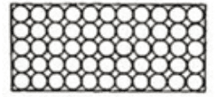
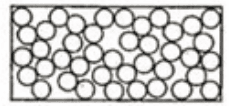
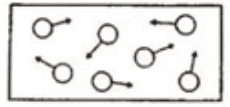

# States of Matter

## Solids, Liquids and Gases

The state of a substance is dependent on its:

1. Temperature

2. Pressure

**Exam-style definitions:**

* Solid: Regular arrangement; particles vibrate about fixed positions; particles very close together.

* Liquid: Randomly arranged; particles move around each other; particles close together.

* Gas: Randomly arranged, particles move quickly in all directions, particles far apart.

### Revision Table

#|
|| **Properties** | **Solid** | **Liquid** | **Gas** ||
|| Particle arrangement |  |  |  ||
|| Forces between particles | Strongest | Weaker than solids | Weakest ||
|| Motion of particles | Vibrate in fixed positions and regular arrangement | Slip and slide over other particles | Move randomly at high speed in all directions ||
|| Shape | Fixed shape | Take the shape of the container | Takes the shape of the container ||
|| Expansion when heated | Expands slightly | Expands more than solids | Expands the most ||
|| Can it be compressed? | No | Slightly | Yes ||
|#
