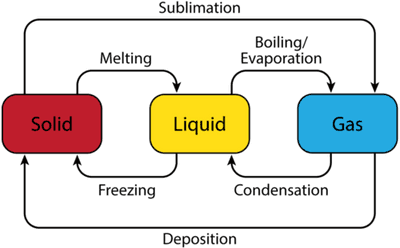

## Changes in the State of Matter

* **Melting point**: When a solid melts
* **Boiling point**: When a liquid turns to a gas
* The melting point and the freezing point are **the same temperature**
* **Freezing point**: When the liquid changes to a solid
* **Boiling**: When a liquid is heated so strongly that all the particles move fast and can overcome the forces of attraction between them.
* **Evaporation**: When some fast-moving particles at the surface of the liquid have enough energy to change into a gas.
* **Sublimation**: Solid to gas
* **Deposition**: Gas to solid

### Particle Changes During Each Transition

#|
|| **Change** | **Arrangement** | **Movement** | **Energy** ||
|| Melting (solid → liquid) | Regular lattice breaks down; particles become randomly arranged but stay close together | Particles go from vibrating about fixed positions to moving around each other | Energy is absorbed; particles gain kinetic energy and overcome some of the forces of attraction ||
|| Freezing (liquid → solid) | Particles become fixed in a regular arrangement | Particles stop moving around each other and only vibrate about fixed positions | Energy is released; particles lose kinetic energy and forces of attraction hold them in place ||
|| Boiling / evaporation (liquid → gas) | Particles go from close together and random to far apart and random | Particles move quickly in all directions | Energy is absorbed; particles gain enough energy to completely overcome the forces of attraction ||
|| Condensation (gas → liquid) | Particles go from far apart to close together, still random | Particles slow down and move around each other | Energy is released; particles lose kinetic energy and forces of attraction pull them together ||
|| Sublimation (solid → gas) | Regular lattice changes straight to particles far apart and random | Particles go from vibrating to moving quickly in all directions | Energy is absorbed; particles gain enough energy to overcome all the forces of attraction without becoming a liquid first ||
|| Deposition (gas → solid) | Particles far apart change straight to a regular lattice | Particles go from moving quickly to only vibrating about fixed positions | Energy is released; particles lose kinetic energy and become fixed in place without becoming a liquid first ||
|#
