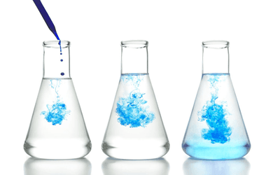

## Diffusion

* **Diffusion**: The spreading out of particles from where they are at a higher concentration to a lower concentration.
* Diffusion in liquids is very slow if the liquid is very still

### Experiment: Diffusion of Gases (Ammonia and Hydrogen Chloride)

* A cotton wool plug soaked in concentrated ammonia solution is placed at one end of a long glass tube, and a plug soaked in concentrated hydrochloric acid is placed at the other end at the same time.
* Both ends are sealed with bungs.
* $NH_3$ and $HCl$ gas particles diffuse along the tube towards each other.
* After a few minutes, a white ring of solid ammonium chloride forms where the gases meet: $NH_3(g) + HCl(g) \rightarrow NH_4Cl(s)$
* The ring forms closer to the hydrochloric acid end.
* This shows that ammonia particles diffuse faster, because they are lighter ($M_r$ of $NH_3$ = 17, $M_r$ of $HCl$ = 36.5).
* **Conclusion**: The lower the relative formula mass of a gas, the faster it diffuses.

### Experiment: Diffusion of Bromine Gas

* A gas jar of brown bromine gas is placed under a gas jar of air, separated by a glass lid.
* When the lid is removed, the brown colour slowly spreads upwards until both jars are the same colour.
* This shows that gas particles move randomly and spread from a high concentration to a low concentration.

### Experiment: Dilution of a Coloured Solution

* Dissolve a few crystals of potassium manganate(VII) in 10 $cm^3$ of water to make a deep purple solution.
* Take 1 $cm^3$ of this solution and add it to 9 $cm^3$ of water. Mix well.
* Repeat this, each time taking 1 $cm^3$ of the previous solution and adding 9 $cm^3$ of water.
* The colour becomes paler with each dilution, but is still visible after several dilutions.
* **Conclusion**: Even a very small amount of solution contains a huge number of particles, so particles must be extremely small. The particles spread out evenly through the water.

### Experiment: Diffusion in a Liquid

* A single crystal of potassium manganate(VII) is placed at the bottom of a beaker of still water.
* The purple colour slowly spreads through all the water over time, without stirring.
* This shows that particles in liquids move randomly and diffuse from a high to a low concentration, but more slowly than in gases.
