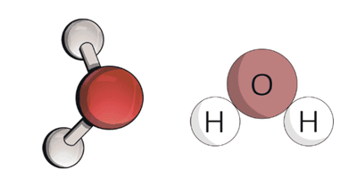

# Atomic Structure

## Structure of the Atom

**Atom** - The smallest part of an element that can still exist and take part in a chemical reaction.

**Molecule** - Two or more atoms chemically joined together.

*A water molecule: one oxygen atom chemically joined to two hydrogen atoms.*

### Positions of Sub-atomic Particles

* An atom has a tiny, dense **nucleus** at its centre.

* The nucleus contains **protons** and **neutrons**, so almost all of the mass of the atom is in the nucleus.

* **Electrons** move around the nucleus in **shells** (energy levels).

* Most of the atom is empty space, because the nucleus is very small compared with the size of the whole atom.

* In a neutral atom, the number of electrons is equal to the number of protons, so the overall charge is zero.

#|
|| **Particle** | **Relative Mass** | **Relative charge** ||
|| Neutron | $1$ | $0$ ||
|| Proton | $1$ | $+1$ ||
|| Electron | $\frac{1}{1836}$ | $-1$ ||
|#

*Relative mass and relative charge of the three sub-atomic particles.*

* **Atomic Number** - Number of protons in the nucleus of an atom

* **Mass Number** - The number of protons and neutrons in the nucleus of an atom

* **Isotopes** - Atoms of the same element that have the same atomic number but a different mass number (same number of protons, different number of neutrons). Same chemical properties, as the number of electrons hasn't changed.

### Atomic Notation

* An atom of an element can be written as $^{A}_{Z}X$, where:

  * $X$ is the symbol of the element

  * $A$ (top) is the **mass number** = number of protons + number of neutrons

  * $Z$ (bottom) is the **atomic number** = number of protons

* Number of neutrons = mass number − atomic number = $A - Z$

* **Example**: $^{23}_{11}Na$

  * Protons = $11$

  * Neutrons = $23 - 11 = 12$

  * Electrons = $11$ (same as the number of protons, as the atom is neutral)

*Atomic notation: the mass number is written at the top left and the atomic number at the bottom left of the element symbol.*

### Relative Atomic Mass

* **Relative atomic mass** - The average mass of 1 atom of an element, taking into account the abundance of all the isotope masses of that element. It is compared to 1/12 of the mass of a carbon–12 atom.

* **Relative atomic mass**: **$A_r = \frac{\sum (\char37\text{ Isotope abundance} \times \text{Isotope mass})}{100}$**

**Worked example**

Chlorine has two isotopes: chlorine-35 (abundance 75%) and chlorine-37 (abundance 25%). Calculate the relative atomic mass of chlorine.

$$
A_r = \frac{(75 \times 35) + (25 \times 37)}{100} = \frac{2625 + 925}{100} = \frac{3550}{100} = 35.5
$$
