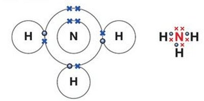
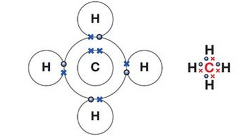
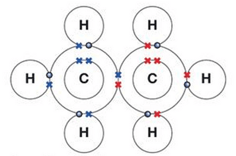

# Covalent Bonding

## Covalent Bonds

A covalent bond is the **electrostatic force** of attraction between the ***nuclei*** of two atoms and a **shared pair of electrons**.

* Usually formed between 2 non-metal atoms.

* Shared electrons are called bonding electrons (they occur in pairs).

* Outer-shell electrons not involved in bonding are non-bonding electrons (lone pairs).

* Single bond = 1 shared pair

* Double bond = 2 shared pairs

* Triple bond = 3 shared pairs

* In a dot-and-cross diagram, the electrons from one atom are drawn as dots and the electrons from the other atom as crosses. Shared pairs are drawn where the outer shells overlap.

### Diatomic Molecules

* A hydrogen molecule is made of two hydrogen atoms joined by a covalent bond, so hydrogen has the formula $H_2$.

* Hydrogen forms molecules because the $H_2$ molecule is more stable than two separate hydrogen atoms.

*Dot-and-cross diagram showing the single covalent bond (one shared pair of electrons) in a diatomic molecule.*

* Examples of diatomic molecules: hydrogen ($H_2$), oxygen ($O_2$), nitrogen ($N_2$) and the halogens, e.g. fluorine ($F_2$) and chlorine ($Cl_2$).

* Oxygen has a double covalent bond, as 4 electrons (2 pairs) are shared.

* Nitrogen has a triple covalent bond, as 6 electrons (3 pairs) are shared.

### Inorganic Molecules

* **Water, $H_2O$**: Oxygen has 6 electrons in its outer shell. It shares 1 electron with each of the 2 hydrogen atoms, forming 2 single covalent bonds. Oxygen is left with 2 lone pairs and now has 8 outer electrons.

* **Ammonia, $NH_3$**: Nitrogen has 5 electrons in its outer shell. It shares 1 electron with each of the 3 hydrogen atoms, forming 3 single covalent bonds. Nitrogen is left with 1 lone pair.

*Dot-and-cross diagram of ammonia: three shared pairs between nitrogen and hydrogen, and one lone pair on nitrogen.*

* **Carbon dioxide, $CO_2$**: Carbon has 4 electrons in its outer shell. It shares 2 electrons with each oxygen atom, forming 2 double covalent bonds ($O=C=O$). Each oxygen atom has 2 lone pairs.

### Organic Molecules

* **Methane, $CH_4$**: Carbon has 4 electrons in its outer shell, so it shares 1 electron with each of the 4 hydrogen atoms, forming 4 single covalent bonds.

*Dot-and-cross diagram of methane: four shared pairs between carbon and hydrogen.*

*Structure of ethane, $C_2H_6$: it contains carbon–hydrogen and carbon–carbon single bonds and is called a hydrocarbon (these structures are covered in more detail in Unit 4).*

* **Ethene, $C_2H_4$**: The two carbon atoms share 2 pairs of electrons, forming a carbon–carbon double bond ($C=C$). Each carbon atom also shares 1 pair with each of its 2 hydrogen atoms.

* **Chloromethane, $CH_3Cl$** (a halogen-containing organic molecule): Carbon shares 1 pair of electrons with each of 3 hydrogen atoms and 1 pair with a chlorine atom. Chlorine has 7 outer electrons, so after sharing 1 pair it has 3 lone pairs.
