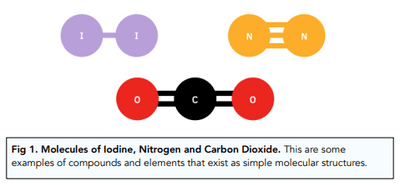

## Simple Molecular Structures

* Simple molecular substances are made of small molecules. The atoms within each molecule are held together by **strong covalent bonds**, but the molecules are held to each other by **weak intermolecular forces**.

* Simple molecular substances can be **gases, liquids or solids** at room temperature, but they all have **low melting and boiling points**. This is because only a small amount of thermal energy is needed to overcome the weak intermolecular forces of attraction. The covalent bonds do not break when the substance melts or boils.

  e.g. $CO_2$ and $CH_4$ are gases, $H_2O$ is a liquid, and iodine ($I_2$) is a solid with a low melting point.

* Poor electrical conductivity, as there are no free electrons or ions to carry the charge.

* Intermolecular forces of attraction increase as the relative molecular mass increases, so melting and boiling points increase too.

* Examples: $H_2O$, $CO_2$, $CH_4$, $NH_3$, $C_2H_4$

### Why Intermolecular Forces Are Weaker Than Covalent Bonds

* A **covalent bond** is the strong attraction between a shared pair of electrons and the nuclei of two atoms. The atoms are very close together, so the attraction is very strong.

* **Intermolecular forces** are the attractions **between** separate molecules. The molecules are much further apart than the atoms within a molecule, and no electrons are shared between them, so the attraction is much weaker.

* This means much less energy is needed to separate molecules from each other (melting or boiling) than to break the covalent bonds inside them.

*Molecules of iodine, nitrogen and carbon dioxide: examples of elements and compounds that exist as simple molecular structures.*
