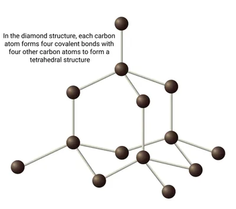
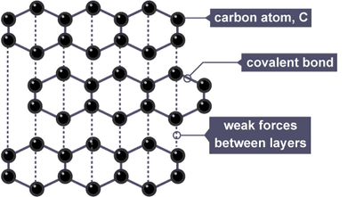
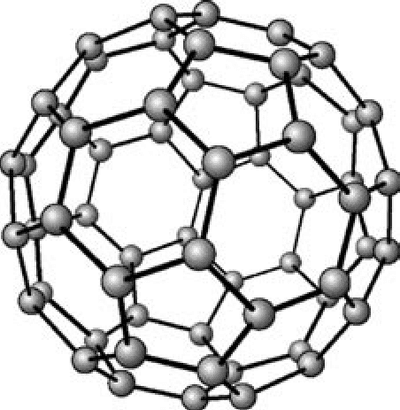

## Giant Covalent Structures

* **Allotropes**: Different forms of the same element. Diamond, graphite and fullerene are allotropes of carbon.

### Diamond

* Pure form of carbon

* Tetrahedral structure

* Each carbon atom bonds strongly to 4 other carbon atoms

* High melting and boiling points, as the strong covalent bonds require a lot of thermal energy to break

* Very hard, as a lot of energy has to be applied to break the strong covalent bonds

* Doesn’t conduct electricity, as all the outer electrons are used in covalent bonds, so none are free to move around

*Structure of diamond: each carbon atom forms four covalent bonds with other carbon atoms in a tetrahedral arrangement.*

### Graphite

* Form of carbon

* Layer structure

* Soft material: even though it has covalent bonds, only the weak forces between the layers have to be overcome, so the layers can easily slide over each other and flake off

* Has high melting and boiling points, as to melt or boil it, the strong covalent bonds within the layers have to be broken, which requires large amounts of thermal energy

* Conducts electricity, as each carbon atom is only bonded to 3 others, so the 4th outer electron of each atom is delocalised. These delocalised electrons are free to move and carry the charge

*Structure of graphite: layers of carbon atoms arranged in hexagons.*

*Graphite layers: each carbon is bonded to 3 others and has 1 free (delocalised) electron. Weak intermolecular forces between layers let the layers slide.*

### Fullerene

* Fullerene ($C_{60}$) is made of separate ball-shaped molecules, so it has a simple molecular structure.

* Lower melting and boiling points than diamond and graphite, as only the weak intermolecular forces between the molecules need to be overcome

* Not as hard as diamond, as it doesn’t take a lot of energy to overcome the weak intermolecular forces

* Doesn’t conduct electricity well. Although each carbon atom has a delocalised electron, these electrons can only move within their own molecule. They cannot move from one molecule to the next, so there are no charged particles that can move through the whole substance to carry the charge.

* Non-toxic, so used in the body for medicines

*Structure of fullerene ($C_{60}$): a hollow, spherical molecule made of 60 carbon atoms.*

### Summary of All Allotropes

#|
||

**Diamond**

|

**Graphite**

|

**Fullerene**

||
||

Giant covalent allotrope of carbon. Each C forms 4 strong covalent bonds in a tetrahedral lattice. Very high MP (many strong bonds to break), hard and dense, doesn't conduct (no free electrons). Silica ($SiO_2$) is similar.

|

Giant covalent allotrope of carbon. Each C forms 3 covalent bonds, making layers of hexagons, with 1 delocalised electron per C, so it conducts. Soft and slippery because weak forces between layers let them slide. High MP because the strong covalent bonds within layers must be broken.

|

Spherical allotrope of carbon, 60 carbon atoms per molecule ($C_{60}$). Simple molecular structure, so it has strong covalent bonds within each ball but only weak intermolecular forces between balls. Low MP/BP because only the weak intermolecular forces need to be overcome.

||
|#

*Comparison of the structure and properties of diamond, graphite and fullerene.*
