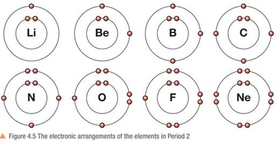

# The Periodic Table

## Arrangement of the Periodic Table

*The modern Periodic Table, with the elements arranged in order of increasing atomic number.*

### Key Features

* **Group** - A vertical column in the Periodic Table. Group number = number of outer electrons. Elements that belong to the same group have similar chemical properties.
* **Period** - A horizontal row in the Periodic Table. Period number = number of occupied electron shells.
* **Periodicity** - The regular, repeating pattern of physical and chemical properties of the elements across each period of the Periodic Table.
* The elements are **arranged in increasing order of atomic number** in the Periodic Table
* Electrons are **arranged around the nucleus in shells** and lower ones are filled before the higher ones
* The first shell can hold a maximum of 2 electrons and the second shell a maximum of 8 electrons. The third shell can hold up to 18 electrons, but for the first 20 elements (up to calcium) only 8 electrons go into the third shell before electrons start filling the fourth shell.
* The arrangement of electrons in its shells is called its electronic configuration

### Electronic Configurations of the First 20 Elements

#|
|| **Element** | **Symbol** | **Atomic number** | **Electronic configuration** ||
|| Hydrogen | $H$ | $1$ | 1 ||
|| Helium | $He$ | $2$ | 2 ||
|| Lithium | $Li$ | $3$ | 2.1 ||
|| Beryllium | $Be$ | $4$ | 2.2 ||
|| Boron | $B$ | $5$ | 2.3 ||
|| Carbon | $C$ | $6$ | 2.4 ||
|| Nitrogen | $N$ | $7$ | 2.5 ||
|| Oxygen | $O$ | $8$ | 2.6 ||
|| Fluorine | $F$ | $9$ | 2.7 ||
|| Neon | $Ne$ | $10$ | 2.8 ||
|| Sodium | $Na$ | $11$ | 2.8.1 ||
|| Magnesium | $Mg$ | $12$ | 2.8.2 ||
|| Aluminium | $Al$ | $13$ | 2.8.3 ||
|| Silicon | $Si$ | $14$ | 2.8.4 ||
|| Phosphorus | $P$ | $15$ | 2.8.5 ||
|| Sulfur | $S$ | $16$ | 2.8.6 ||
|| Chlorine | $Cl$ | $17$ | 2.8.7 ||
|| Argon | $Ar$ | $18$ | 2.8.8 ||
|| Potassium | $K$ | $19$ | 2.8.8.1 ||
|| Calcium | $Ca$ | $20$ | 2.8.8.2 ||
|#

*Electronic configurations of the first 20 elements. Each number is the number of electrons in a shell, starting from the shell nearest the nucleus.*

*Electronic arrangements of the elements in Period 2 (lithium to neon). Each has two shells, and the number of outer electrons increases by one across the period.*

### Deducing Electronic Configuration from the Periodic Table

* For the main group elements, the position of an element tells you its electronic configuration:

  * **Period number** = number of occupied shells

  * **Group number** = number of electrons in the outer shell (for Groups 1 to 7)

  * **Group 0** elements have a full outer shell

* **Worked example 1**: Sulfur is in Period 3 and Group 6. So it has 3 occupied shells and 6 electrons in its outer shell. The first two shells are full (2 and 8), so the electronic configuration is **2.8.6**. Check: $2 + 8 + 6 = 16$, which is the atomic number of sulfur.

* **Worked example 2**: An element has the electronic configuration 2.8.2. It has 3 occupied shells, so it is in **Period 3**, and 2 outer electrons, so it is in **Group 2**. Its atomic number is $2 + 8 + 2 = 12$, so the element is **magnesium**.

### Why Elements in the Same Group Have Similar Properties

* Chemical reactions involve the electrons in the **outer shell**.

* Elements in the same group have the **same number of outer electrons**, so they react in similar ways. For example, all Group 1 elements have 1 outer electron, which they lose to form $1+$ ions.

### Why Noble Gases Do Not Readily React

* Noble gases (Group 0) have a **full outer shell** of electrons (2 for helium, 8 for the others).

* A full outer shell is very stable, so noble gases do not need to lose, gain or share electrons. This is why they are unreactive and exist as single atoms.

#|
||

**Family**

|

**Properties**

||
||

Alkali metals (Group 1)

|

Bases that are soluble in water, and are metals too; form \+1 ions.

||
||

Alkaline earth metals (Group 2)

|

Insoluble bases (also called bases), found in the earth's crust.

||
||

Halogens (Group 7)

|

Non-metals that react with metals from Group 1 to form salts. Halogens can also react with hydrogen to form acids (a hydrogen ion, H⁺, is released in this process).

||
||

Noble gases (Group 0)

|

Unreactive, stable, monoatomic (exist as single atoms), colourless, non-flammable.

||
||

Metalloids

|

Exhibit properties of both metals and non-metals, e.g. silicon (Si), arsenic (As), boron (B).

||
|#

*Properties of the main families of elements in the Periodic Table.*

Helium → an exception: it has 2 outer electrons but is in Group 0 (its shell is full, so it behaves as a noble gas).

### Reactivity Trends

* Group 1 metals become more reactive as you move down the group.

* Group 7 elements decrease in reactivity as you move down the group.
