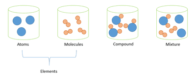

# Elements, Compounds and Mixtures

## Pure Substances and Mixtures

* **Elements**: A substance made up of atoms that all contain the same type of atom and cannot be split into anything simpler.

  e.g. hydrogen, oxygen, carbon

* **Compounds**: A pure substance made up of 2 or more elements chemically combined together. Cannot be separated through physical methods.

  e.g. copper(II) sulphate, calcium carbonate

* **Mixture**: A combination of 2 or more substances (elements and/or compounds) that are not chemically joined together. Can be separated through physical methods.

  e.g. salt \+ water solution, air

  

* **Pure substances**: Melt and boil at fixed temperatures

* **Mixtures**: Boil over a range of temperatures
