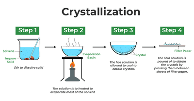
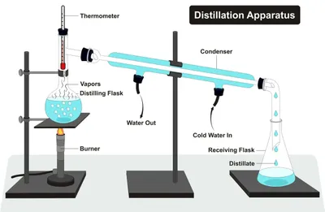

## Methods to Separate Mixtures

### Filtration

* **Principle**: Filtration separates an insoluble solid from a liquid. The solid particles are too large to pass through the tiny holes in the filter paper, but the liquid (and anything dissolved in it) can pass through.

* **Method**:

  1. Fold a piece of filter paper into a cone and place it in a filter funnel over a beaker or conical flask.

  2. Pour the mixture into the filter paper.

  3. The liquid drains through the filter paper and collects in the beaker, while the solid stays in the filter paper.

* **Residue**: The insoluble solid left behind in the filter paper

* **Filtrate**: The liquid that drains through the filter paper

### Crystallisation

* Used to separate a solute from a solution

  The solution is heated to allow a saturated solution to form and tested by dipping a glass rod onto the surface of the solution and seeing if crystals form on the surface when removed. The Bunsen burner is turned off and crystals are formed as water evaporates and the solution cools. The crystals can be removed by filtration.

### Simple Distillation

* Used to separate the components of a solution. The liquid boils and is condensed back into a liquid by the condenser, leaving the solid behind in the flask.

### Fractional Distillation

* Used to separate a mixture of liquids from each other like ethanol and water as they are completely miscible with each other

* It works because the liquids have **different boiling points**.

* **How it differs from simple distillation**:

  * Simple distillation separates a liquid from a dissolved solid, whereas fractional distillation separates two or more liquids from each other.

  * Fractional distillation uses a **fractionating column** between the flask and the condenser.

* **How it works**:

  1. The mixture is heated. The liquid with the lower boiling point (ethanol, 78 °C) evaporates more readily than the liquid with the higher boiling point (water, 100 °C).

  2. The vapours rise up the fractionating column, which is packed with glass beads. The column is hottest at the bottom and coolest at the top.

  3. Vapour of the liquid with the higher boiling point (water) condenses on the glass beads and drips back into the flask.

  4. Vapour of the liquid with the lower boiling point (ethanol) reaches the top of the column, passes into the condenser, condenses and is collected.

  5. The thermometer at the top of the column stays at the boiling point of ethanol while ethanol is distilling. When the temperature starts to rise, all the ethanol has been removed and the next liquid begins to distil.

### Paper Chromatography

* Used to separate a variety of mixtures like coloured inks and food dyes.

* The substances separate because they have different solubilities in the solvent. The more soluble a substance is, the further it travels up the paper.

**Interpreting a chromatogram**

* A **pure substance** produces only **one spot**.

* A **mixture** produces **two or more spots**, one for each substance in it.

* If a spot from the mixture is at the same height as a spot from a known substance (using the same solvent), they are likely to be the same substance.

* A substance that is insoluble in the solvent stays on the start line.

* The $R_f$ value can be used to identify a substance by comparing it with the $R_f$ values of known substances.

$$
R_f = \frac{\text{distance moved by spot}}{\text{distance moved by solvent front}}
$$

* $R_f$ stands for retention factor.

* The $R_f$ value is always between 0 and 1. It has no units.

**Practical: investigating the composition of inks**

* Draw a start line in **pencil** about 2 cm from the bottom of the chromatography paper. Pencil is used because it does not dissolve in the solvent, whereas ink would.

* Place small spots of each ink or food colouring on the start line, along with spots of known dyes for comparison.

* Use the same solvent and the same type of chromatography paper for each sample.

* Place the paper in a beaker containing a small amount of solvent, so that the start line is **above** the solvent level. Otherwise, the spots would dissolve into the solvent instead of moving up the paper.

* Cover the beaker with a lid to stop the solvent evaporating.

* Remove the paper when the solvent almost reaches the top of the paper, and mark the solvent front in pencil.

* Allow the paper to dry, then measure the distances and calculate the $R_f$ values.

* **Expected observations**: Each ink separates into the dyes it contains, which appear as separate spots at different heights. An ink made of only one dye gives a single spot.

* **Safety**: If a flammable solvent such as ethanol is used, keep it away from naked flames and work in a well-ventilated area. Wear eye protection.

* **Variations**: If a spot does not move from the start line, the substance is insoluble in that solvent, so the experiment can be repeated with a different solvent (e.g. ethanol instead of water).

