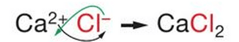
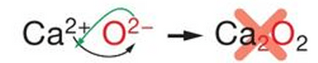

## Finding the Formula of an Ionic Compound

* An ionic compound has no overall charge, so the **total positive charge must equal the total negative charge**.

* **Crossing the charges**: Write the charge number of each ion as the subscript of the other ion.

*Crossing the charges for calcium chloride: $Ca^{2+}$ and $Cl^{-}$ give $CaCl_2$.*

* Just cross the charges of the elements over. The charge on chlorine ($Cl^{-}$) is 1, so no extra number is added after $Ca$.

*Calcium oxide: $Ca^{2+}$ and $O^{2-}$ have charges of the same size, so the formula is simply $CaO$.*

* If the charges are the same size, there is no need to cross the charges, as they already balance.

### Compounds Containing Polyatomic Ions

* If more than one polyatomic ion (e.g. $OH^{-}$, $NO_3^{-}$, $SO_4^{2-}$, $NH_4^{+}$) is needed, put the ion in **brackets** and write the number outside.

### Worked Examples

#|
|| **Compound** | **Ions** | **Balancing the charges** | **Formula** ||
|| Aluminium oxide | $Al^{3+}$ and $O^{2-}$ | $2 \times (+3) = +6$ and $3 \times (-2) = -6$ | $Al_2O_3$ ||
|| Calcium hydroxide | $Ca^{2+}$ and $OH^{-}$ | $+2$ and $2 \times (-1) = -2$ | $Ca(OH)_2$ ||
|| Copper(II) nitrate | $Cu^{2+}$ and $NO_3^{-}$ | $+2$ and $2 \times (-1) = -2$ | $Cu(NO_3)_2$ ||
|| Iron(III) sulfate | $Fe^{3+}$ and $SO_4^{2-}$ | $2 \times (+3) = +6$ and $3 \times (-2) = -6$ | $Fe_2(SO_4)_3$ ||
|| Ammonium carbonate | $NH_4^{+}$ and $CO_3^{2-}$ | $2 \times (+1) = +2$ and $-2$ | $(NH_4)_2CO_3$ ||
|#

*Worked examples of writing formulae of ionic compounds by balancing the charges.*

### Working Out the Charge on an Ion

* You can work backwards from a formula to find the charge on a metal ion.

* **Worked example**: What is the charge on the iron ion in $Fe_2O_3$?

  * Three $O^{2-}$ ions give a total charge of $3 \times (-2) = -6$.

  * So the two iron ions must have a total charge of $+6$, which means each iron ion is $Fe^{3+}$.

### Practice Questions

1. Write the formula of: (a) lead(II) nitrate (b) iron(II) hydroxide (c) silver carbonate (d) zinc sulfate (e) ammonium sulfate

2. What is the charge on the copper ion in $CuO$?

3. What is the charge on the metal ion in $PbCl_2$?

**Answers:**

1. (a) $Pb(NO_3)_2$ (b) $Fe(OH)_2$ (c) $Ag_2CO_3$ (d) $ZnSO_4$ (e) $(NH_4)_2SO_4$

2. $Cu^{2+}$, because one $O^{2-}$ ion has a charge of $-2$

3. $Pb^{2+}$, because two $Cl^{-}$ ions have a total charge of $-2$
