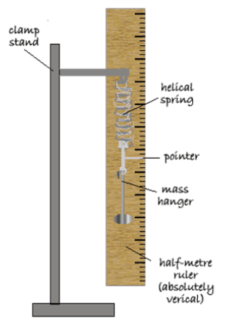

# Forces and Motion

## Investigate how extension varies with applied force for helical springs

1. Hang a Spring to a clamp stand with a meter ruler parallel to it.
2. Measure the length of the spring with no attached weight.
3. add (100g/1N) weight to the spring and record the new length.
4. Repeat it 5 times, each time adding 100g and recording the new length.
5. Using the formula, Extension = New length - Initial length and draw a table with it.
6. Plot it on the graph.

    

