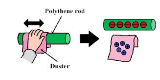

# Electricity (Electric Charge)

## Investigate how insulating materials can be charged by friction

* Hold polythene rod and cloth next to up small pieces of paper one at a time, observe.
* Now rub the rod with the cloth
* Again hold close to small pieces of paper, observe.
* Turn on a tap so a thin stream of water is flowing
* Hold the rod about 1cm away from the water just below the nozzle, observe
* Repeat with different material rods and cloths

 