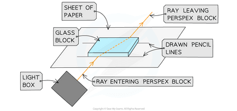

# Waves (Light and Sound)

## Investigate the refraction of light, using rectangular blocks, semi-circular blocks and triangular prisms

1\.       Set up your apparatus as shown in the diagram using a **rectangular block**.

2\.       Shine the light ray through the glass block

3\.       Use **crosses** to mark the path of the ray.

4\.       Join up crosses with a ruler

5\.       Draw on a **normal** where the ray enters the glass block

6\.       **Measure** the angle of incidence and the angle of refraction and add these to your results table

7\.       Comment on how the speed of the light has changed as the light moves between the mediums.

8\.       **Repeat this** for different angles of incidence and different glass prisms.

 