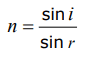

## Investigate the refractive index of glass, using a glass block

1. Set up your apparatus as shown in the diagram using a **rectangular block**.
2. Shine the light ray through the glass block
3. Use **crosses** to mark the path of the ray.
4. Join up crosses with a ruler
5. Draw on a **normal** where the ray enters the glass block
6. **Measure** the angle of incidence and the angle of refraction and add these to your results table
7. **Calculate** the refractive index. Using n = sin(i) / Sin(r)
8. Repeat steps 2 – 7 using a different angle of incidence
9. Find an **average** of your results.

 