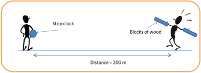
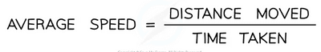

## Investigate the speed of sound in air

 

1. Use the trundle wheel to measure a distance of Minimum 100 m between two people
2. One of the people should have two wooden blocks, which they will bang together above their head to generate sound waves
3. The second person should have a stopwatch which they start when they see the first person banging the blocks together and stop when they hear the sound
4. This should be repeated several times and an average taken for the time travelled by the sound waves

    

