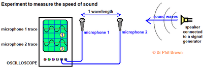

## Investigate the frequency of a sound wave using an oscilloscope

1. Connect two microphones to an oscilloscope
2. Place them about 2 m apart using a tape measure to measure the distance between them
3. Set up the oscilloscope so that it triggers when the first microphone detects a sound, and adjust the time base so that the sound arriving at both microphones can be seen on the screen
4. Make a large clap using the two wooden blocks next to the first microphone
5. Use the oscilloscope to determine the time at which the clap reaches each microphone and the time difference between them
6. Repeat this experiment for several distances, e.g. 2 m, 2.5 m, 3 m, 3.5 m

    

