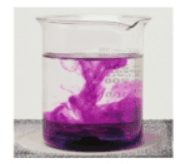
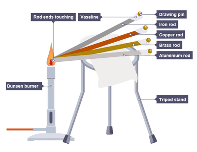
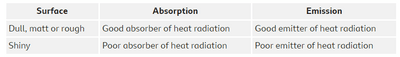
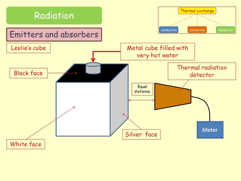

# Energy Resources and Energy Transfers (Energy transfers)

## Investigate thermal energy transfer by conduction, convection and radiation

### Thermal Convection

* Place purple potassium permanganate crystals in 1 side of a beaker full of cold water.

* Heat beaker with Bunsen burner.

* The Convection Current will be seen as it dissolves

### Thermal Conduction

* Fix the drawing pin to the end of the metal strip using spots of Vaseline.

* Position the other end of the metal strip into a Bunsen flame.

* Record the time taken for the wax to melt and the drawing pin to drop off.

* The fastest time shows the best conductor of heat.

  

### Radiation

* Measure the temperature a fixed distance from each side of a Leslie's cube using four identical thermometers.

* Heat the Leslie’s cube by filling it with boiling water.

* Continue to measure and record the temperatures every 30 seconds for five minutes, then plot a graph of temperature on the y-axis, against time on the x-axis, for each side.

* Compare the four graphs obtained.

