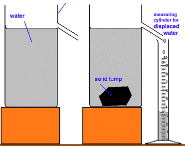

# Solids, liquids and gases (Density and pressure)

## Investigate density using direct measurements of mass and volume

* The density of an object can be found by measuring the mass and volume and applying the formula above to calculate the density.
* For a regular object use a ruler to measure the lengths needed to determine the volume.
* For an irregular object submerge it in water and measure the displaced volume.
* Measure the mass of either type of object using a measuring balance.

 