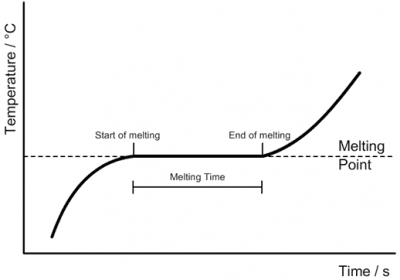

## Obtain a temperature–time graph to show the constant temperature during a change of state

- Remove the boiling tube of stearic acid from the water bath

- Place the tube into a beaker of room temperature water

- Add a separate thermometer to the water

- Take readings from the thermometer in the stearic acid and the water every minute [Make sure to avoid parallax error while doing so]

- Note readings in the table below

- Note on the table when you observe the stearic acid change from a liquid to a solid.

- Plot your results in a graph

