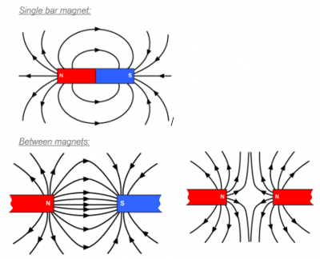

# Magnetism

## Investigate the magnetic field pattern for a permanent bar magnet and between two bar magnets

1. Place your bar magnet in the centre of the next page and draw around it.
2. Place a compass at one pole of the bar magnet.
3. Draw a ‘dot’ to show there the compass is pointing,
4. Move the compass so the opposite end of the needle is pointing to the dot,
5. Repeat steps 3 and 4 until to reach the other pole of the magnet.
6. Do this procedure at least 5 times from different points on the pole of the magnet. \n *\*Tip, try to be as accurate as possible when drawing your dots\**
7. Join up your dots to create the field line plots

    

