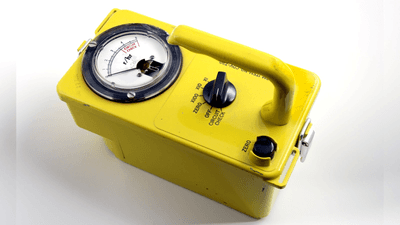

# Radioactivity

## Investigate the penetration powers of different types of radiation using either radioactive sources or simulations

- Detect using a Geiger Müller Tube.

- Try the three different materials in order, paper then aluminium then lead.

- Count rate will significantly decrease if radiation is stopped.

  