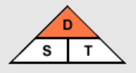
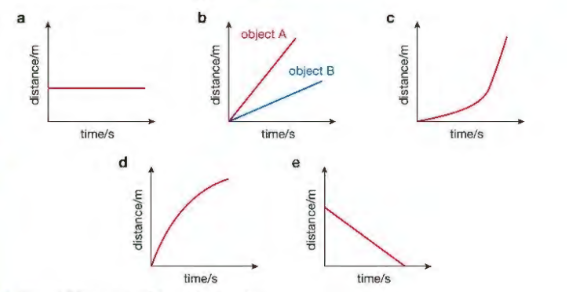
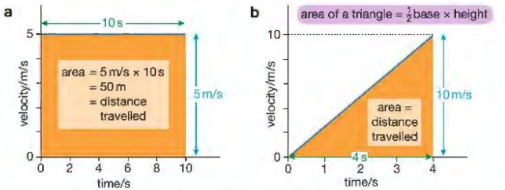

# Forces And Motion

## Movement and Position

* Speed is a scalar quantity.

$$

\text{Average speed}, v= \frac{\text{Total Distance}}{\text{Total Time (t)}}

$$

* Units for speed: m/s, km/h, cm/s, mph
  However, in the IGCSEs, we use metric units. Hence, always use m/s.

**Distance-time graphs:**

* They indicate how much a vehicle has travelled within a given interval. The gradient (slope) of distance-time graphs indicates speed.
* Speed= $\frac{\text{Distance}}{\text{Time}}$ = $\frac{y_2-y_1}{x_2-x_1}$

The steeper the gradient, the higher the speed. As it can be seen in the above graphs

* Graph (a) has zero speed.
* In Graph (b), Object A has a higher speed than Object B.
* Speed is increasing in Graph (c).
* Speed is decreasing in graph (d).
* Lastly, speed is constant in graph (e).
* Vector quantities have both magnitude as well as direction.
* For example, displacement is distance but with a particular direction, whereas velocity is speed with a particular direction.

### **Acceleration**

* Average velocity= total change in displacement divided by total time taken

* Acceleration is the rate of change of velocity.

$a=\frac{\text{change in velocity}}{\text{time taken}}= \frac{v-u}{t}$

* Negative acceleration is known as deceleration.

**Velocity-time graphs:**

* They indicate the velocity of a particle within a given amount of time. The gradient of velocity-time graphs indicates acceleration.
* The area under the graph of a velocity-time graph indicates the total distance travelled as,

$$

\text{Total distance} s = v \times t

$$

