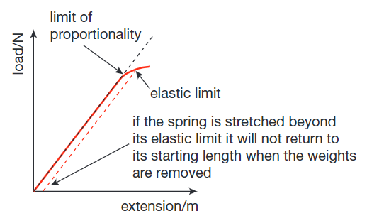
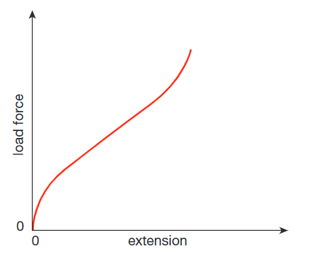

## Forces and Shape

* Force is a vector quantity
  * Some examples of forces are friction, upthrust, weight, normal reaction force, etc. Its unit is Newton (N).
* In most situations, more than one force will act on the object.
* An unbalanced force can be calculated by considering the magnitude and direction of the forces acting on a particular object.
* If forces are unbalanced, it can cause the object to change the way it moves. If balanced, the forces will have no effect.
* **Friction** is the force that causes moving objects to slow down and finally stop. 
  * Friction occurs when solid objects rub against other solids and also when objects move through fluids.
* **Forces** can also change the shape of an object. These changes in
  shape can be both temporary or permanent.
* E.g.  Elastic band, it returns to its original position after being
  stretched (temporary).
* E.g.  Glass (permanent)
* Springs stretch when force is applied and returns to its original
  position after force is removed.

**Hooke’s Law:**

* This law states that the extension of the spring is directly proportional to the force applied. The graph obtained by plotting force against extension is a straight line passing through the origin.
* It is applicable only up to a certain point called the limit of proportionality. This is where the spring stops obeying Hooke’s law and starts stretching more for each load force increase.
* Once the elastic limit has been reached, the spring will not return to its original length.

* Elastic bands are made of rubber. When they are stretched, graphs
  like this are achieved.

