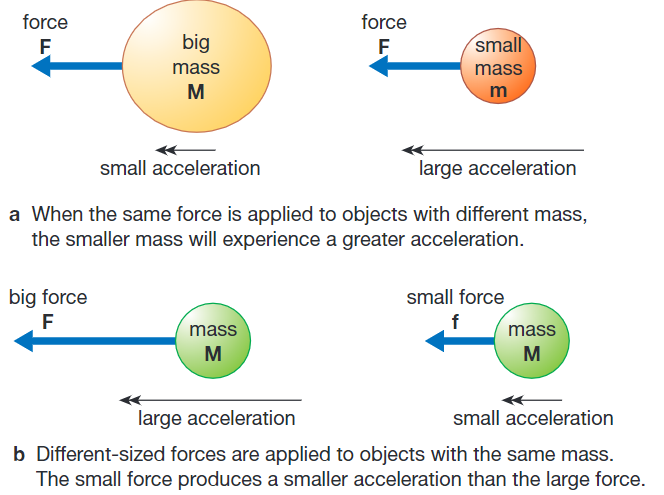
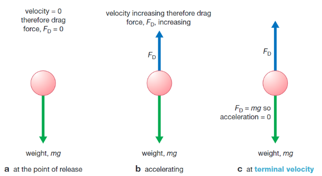
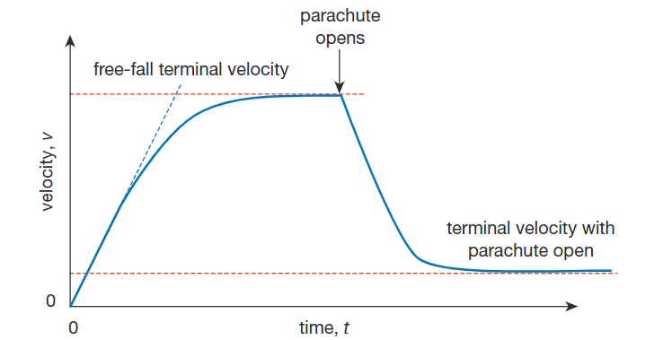

## Forces and Movement

* If unbalanced forces are acting on an object, the object may accelerate or decelerate depending on the direction of the unbalanced force.
* The acceleration depends on the size of the unbalanced force and the
  mass of the object.

* When mass is constant, the graph of force against acceleration is a straight line passing through the origin.
* Therefore, *F* ∝ *a*.

$$

F = ma

$$

* Brakes on cars and bicycles work by increasing the friction between the rotating wheels and the vehicle's body.
* However, if the road is wet or the tires are in bad condition, the frictional force will be smaller. If the brakes are too hard, the tires will not grip the road surface, and the car will skid.
* It can take a driver an amount of time to react to a new object or
  situation in front of them. The time they take to react is known as
  reaction time.
* The amount of distance travelled during this reaction time is known
  as thinking distance.
* The distance travelled within the time when brakes are first applied
  and the car stops is known as braking distance.
* The weight of an object is the force that acts on it because of
  gravity.

$$
W = mg

$$

* An object moving through air experiences a force that opposes its movement known as air resistance or drag.
* The size of the drag force acting on an object depends on its shape
  and its speed.
* The drag coefficient is a measure of how easily an object moves
  through the air.

Velocity–time graph for a free-fall parachutist reaching terminal velocity:

