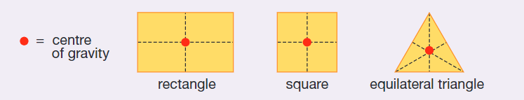

## The Turning Effect of Forces

* All objects are turned around a fixed point called a pivot.
* The turning effect of the force depends on both the size of the force applied and the distance from the hinge or pivot at which it is applied.
* **Moment (Nm) = force (N) × perpendicular distance from pivot, d (m)**

$$

\text{Moment} = F \times d

$$

* An object will be in balance if the sum of anticlockwise moments = the sum of clockwise moments.
* The point through which the entire weight of a body acts is known as its centre of gravity.

* The position of the centre of gravity of an object will affect its stability. The lower the centre of gravity, the more stable the object.