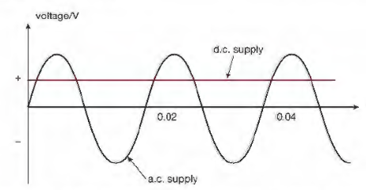
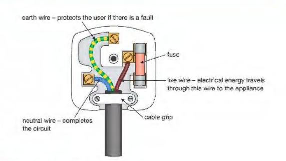
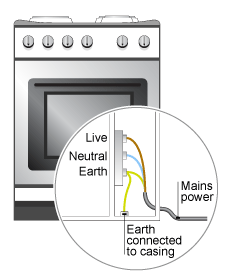

# Electricity

## Mains Electricity

* Power is m­­­­­­­easured in joules per second or watts.

$$

P = I \times V

$$

* Watts = Ampere $\times$ Volts
* Energy = Power $\times$ Time
  * $E = P \times t$
  * Joules = Watt $\times$ Seconds
* Varying current or voltage in an appliance is called an alternating
  current (a.c.) or alternating voltage.
* Currents and voltages that are always in the same direction and have
  the same value is called direct current (d.c.) or direct voltage.

**How devices are protected:**

|Fuse|Circuit Breaker|
|:---|:---|
|A fuse protects a circuit. Thin piece of wire which overheats and melts if current is too high. It is placed on the live wire before the switch. This prevents overheating and catching fire. A fuse will have a specific current value (e.g. 13 amps.) So when choosing a suitable fuse you must use the one above minimum value but less than maximum value|An automatic switch which if current rises over a specified value, the electromagnet pulls the contacts apart, breaking the circuit. The reset button is to rest everything. It works like a fuse but is better because it can be reset.|
|||

* Some modern appliances use casings made from an insulator such as
  plastic. This is known as insulation.
* If all the electrical parts of an appliance are insulated in this
  way, so that they cannot be touched by the user, the appliance is
  said to have double insulation. Appliances that have double
  insulation use a two-wire flex. There is no need for an earth wire.
* **Benefits of Earthing a Metal Case:**
  * Many electrical appliances, have metal cases, the earth wire
    creates a safe route for current to flow through if the live
    wire touches the casing
  * Earth terminal connected to metal casing, so in such a case, the
    current goes through earth wire instead of causing an electric
    shock.
  * A strong current surges through earth wire because it has very
    low resistance
  * This breaks the fuse and disconnects the appliance
* The wires of a heating element are designed to have a high
  resistance so that as the current passes through them, energy is
  transferred and the element heats up.
* We use this heating effect of current in many different appliances
  in our homes such as kettles, dishwashers, electric cookers, etc.

