## Current and Voltages in circuits

* An electric current is a flow of charge.
* Electrons flow easily through all metals, so they are labelled as
  good conductors of electricity.
* Electrons do not flow easily through plastics - they are poor
  conductors of electricity, or, an insulator.
* We measure the size of the current in a circuit using an ammeter.
* Charge, **Q** (coulombs) = Current, **I** (amps) $\times$ time, **t** (seconds)

$$

Q = I \times t

$$

* Energy transferred, **E** (joules) = Charge, **Q** (Coulombs) $\times$ Voltage,
  **V** (volts)

$$

E = Q \times V

$$

**There are two main types of electrical circuit:**

* Series circuit
* Parallel circuit
* The current at any point in a series circuit is the same
* The current splits at each branch in a parallel circuit so the total
  current is always greater than the current in one branch
* Combining resistors
  * In Series: $R_{Total} = R_1 + R_2$
  * In Parallel: $R_{Total} = \frac{1}{\frac{1}{R_1} + \frac{1}{R_2}}$
  * The combined resistance of 2 resistors in parallel is less than that of either resistor by itself and the current in the two resistors in greater in the source than in the individual resistors and is equal to the sum of the currents in all the resistors connected in parallel.
* Advantages of putting lamps in parallel are:
  * If one lamp breaks, the other still works
  * Each lamp gets maximum potential difference
* In series: potential difference across the supply = potential difference across all the components
  combined
* In parallel: Current across the source = sum of currents in the
  separate branches.
* The relationship between current, voltage and resistance is
  expressed by Ohm's Law.
* This states that the current flowing in a circuit is directly
  proportional to the applied voltage and inversely proportional to
  the resistance of the circuit, provided the temperature remains
  constant.

### **Circuit symbols**

* **Cell**

* **Battery of cells**

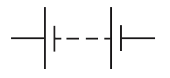

* **Power supply**

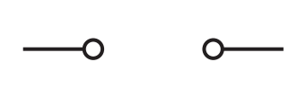

* **A.C. Power Supply**

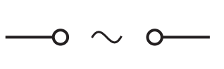

* **Junction of conductors**

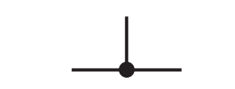

* **Lamp**

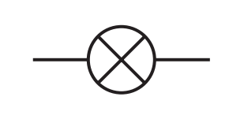

* **Fixed resistor**

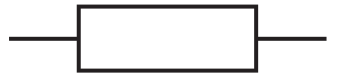

* **Thermistor**

* **Variable Resistor**

* **Light dependent resistor**

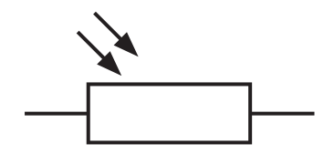

* **Heater**

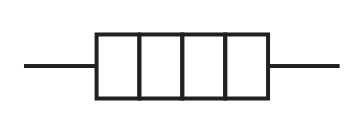

* **Switch**

* **Earth or Ground**

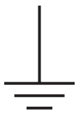

* **Electric Bell**

* **Buzzer**

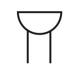

* **Microphone**

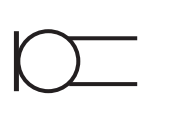

* **Loudspeaker**

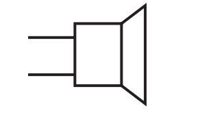

* **Motor**

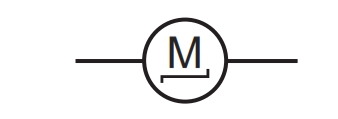

* **Generator**

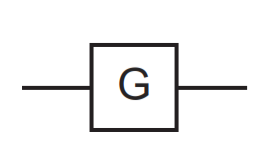

* **Ammeter**

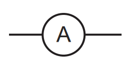

* **Voltmeter**

* **Galvanometer**

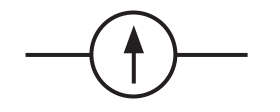

* **Potential Divider**

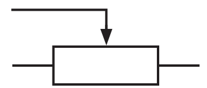

* **Relay Coil**

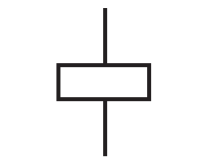

* **Transformer**

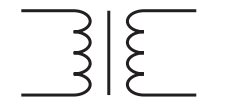

* **Diode**

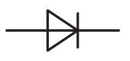

* **Light- emitting diode**

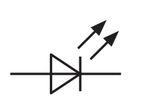

* **Fuse**

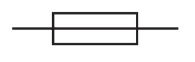

* **Oscilloscope**

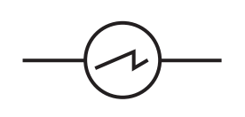

* **AND gate**

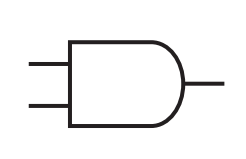

* **OR gate**

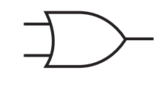

* **NAND gate**

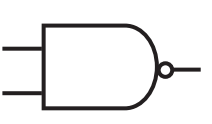

* **NOR gate**

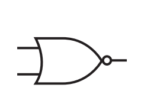

* **NOT gate**

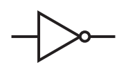