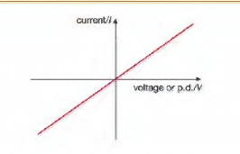
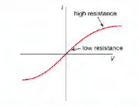
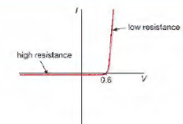
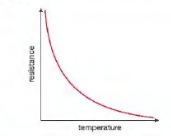
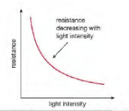

## Electrical Resistance

* **V** (volts) = **I** (amps) $\times$ **R** (ohms)
* We measure resistance in units called ohms ($\Omega$).

**Current voltage graph for a wire:**

**Current voltage graph for a filament bulb:**

**Current voltage graph for a diode:**

* Materials such as plastic, rubber, glass and wood do not allow
  electricity to flow through them easily. They are electrical
  insulators.
* **Types of resistors:**
  * Variable resistor is used to control the size of the current in a bulb.
  * If the resistance is decreased, there will be a larger current and the bulb shines more brightly.
  * If the resistance is increased the current will be smaller and the bulb will glow less brightly or not at all.
  * A thermistor is a resistor whose resistance changes with small changes in temperature.

* A light-dependent resistor (LDR) has a resistance that changes when light is shone on it. In the dark its resistance is high but in light, its resistance is low.
* Diodes are very special resistors that allow charges to flow in one direction. Some diodes glow when charges flow through them. They are called light emitting diodes (LEDs).

