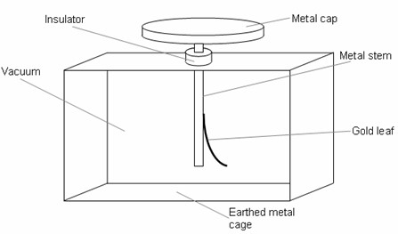
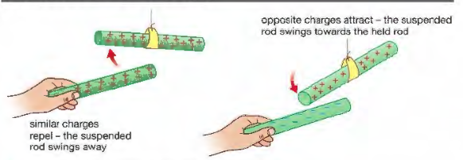
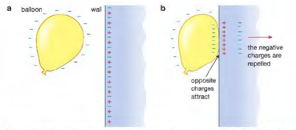

## Electric Charge

* 2 types of charges: positive and negative.
* Unlike charges attract and like charges repel.
* SI unit of charge is the Coulomb (C).
* The presence of an electrostatic charge can be detected using a leaf
  electroscope.
  * If a charged object is placed near the cap, charges are induced.
  * The metal cap gets one type of charge (positive or negative) and
    the metal stem and gold leaf get the other type of charge so
    they repel each other.

* All atoms contain small particles called protons, neutrons and
  electrons.

||**Charge**|**Mass(AMU)**|**location**|
|:---|:---|:---|:---|
|**Proton**|+1|1|Nucleus|
|**Neutron**|0|1|Nucleus|
|**Electron**|-1|0|Orbitals|

* If an atom gains extra electrons, it is then negatively charged.
* If an atom loses electrons, it becomes positively charged.
* An atom that becomes charged by gaining or losing electrons is
  called an ion.
* When electrical insulators of different materials are rubbed
  together, they become charge.

* Painting an awkwardly shaped object with a spray gun can take a long
  time and use a lot of paint. Hence, electrostatic spraying is used
  to make the process much more efficient.
* **Uses of static electricity:**
  * Electrostatic Paint Spraying
  * Inkjet Printers
  * Photocopiers
  * Electrostatic Precipitator
* **Problems of static electricity:**
  * As aircraft fly through the air, friction causes them to become charged with static electricity. Solution: Earth the plane with a conductor as soon as it lands, before refuelling.