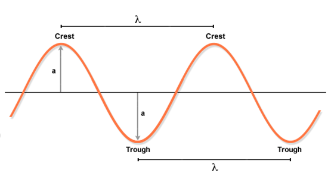
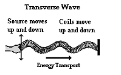
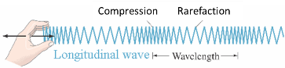
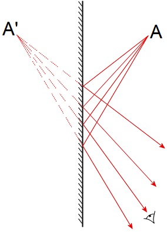

# Waves

## Properties of Waves

* **Waves** are a way of transferring energy from place to place.
* Wavefronts are created by overlapping lots of different waves. A
  wavefront is a line where all the vibrations are in phase and the
  same distance from the source.
* Equation: Wave speed = Frequency × Wavelength

$$

v  = f \lambda

$$

* **Frequency:** It is the number of waves passing any point per
  second measured in hertz (Hz)

$$
Frequency = \frac{1}{\text{Period}}
$$

$$
f = \frac{1}{T}
$$

* **Period:** time taken for one oscillation in seconds
* **Wavefront:** the peak of a transverse wave or the compression of a
  longitudinal wave
* **Speed:** how fast the wave travels measured in m/s
* **Wavelength:** distance between a point on one wave to the
  corresponding point on the next wave in length
* **Amplitude:** maximum displacement of a wave from its undisturbed
  point.

|Transverse Waves|Longitudinal Waves|
|:---|:---|
|Travelling waves in which oscillation is perpendicular to direction of travel|Travelling waves in which oscillation is parallel to direction of travel.|
|Has crests and troughs|Has compressions and rarefactions|
|For example, light, water waves and vibrating string|For example, sound waves, seismic waves, p waves|

* At higher frequencies, the transverse waves have shorter wavelengths. The speed of the waves does not change.
* Plane (flat) mirrors produce a reflection.
* Rays from an object reflect off the mirror into our eyes, but we see
  them behind the mirror.
* The image has these properties:
  * Image is the same size as the object
  * Image is the same distance from the mirror as object
  * A line joining corresponding points of the image and object meet the mirror at a right angle
  * Image is virtual: no rays actually pass through the image and the image cannot be formed on a screen

* **Doppler effect:** It is the change in wave frequency during the
  motion between a wave source and its observer.
* For example, when a sound object moves towards us, the frequency of
  the sound waves increases and hence a higher pitch is produced.