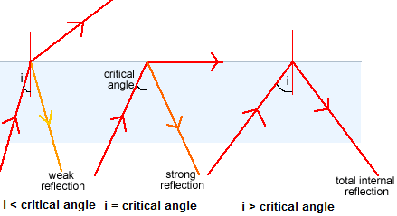

## Light Waves

- Light waves are transverse waves that can be reflected and
  refracted.

- Laws of reflection:

  - Angle of incidence = Angle of reflection

  - The incident ray, reflected ray and normal are always on the same plane (side of mirror)

- **Critical angle**: angle at which refracted ray is parallel to the
  surface of material.

- If the angle of incidence is greater than the critical angle there
  is no refracted ray, there is total internal reflection.

- If the angle of incidence is less than the critical angle the
  incidence ray will split into a refracted ray and a weaker reflected
  ray.

- **Total internal reflection**: It only occurs when rays of light are
  travelling towards a boundary with a less optically dense medium (a
  medium with a lower refractive index).

- Use of total internal reflection: Optical fibres, submarines, etc.

- As the fibres are very narrow, light entering the inner core always
  strikes the boundary of the two glasses at an angle that is greater
  than the critical angle.

- No light escapes across this boundary, providing a path that the
  light follows even when the fibre is curved.

- Different materials can bend rays of light by different amounts. We
  describe this by using a number called the **refractive index**
  (n).

- The refractive index of glass is about 1.5 and water is 1.3.

- We can use the equation below to calculate the refractive index of a
  material:

$$

n = \frac{\sin(\mathbb{i})}{\sin(r)}

$$

(where *i* is the angle of incidence and *r* is the angle of refraction)

- Another equation can be extracted:

$$

\sin(c) = \frac{1}{n}

$$