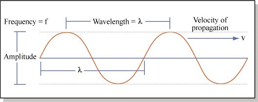
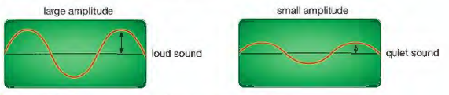

## Sound Waves

* Sounds are produced by objects that are vibrating.
* Speed of sound can be calculated using, $d = v \times t$.
* Some other properties of sound:
  * Sound waves are **longitudinal**: they have compressions and rarefactions and oscillate backwards and forwards.
  * Sound waves need a medium to travel through as it moves due to oscillating particles.
* Compression: High pressure section of a longitudinal wave
* Rarefaction: Low pressure section of a longitudinal wave

* The higher the frequency, the higher the pitch.
* The higher the amplitude, the louder the sound.
* The audible range for humans is 20Hz-20000Hz.
* Frequency above the audible range is known as ultrasound; frequency below the audible range is known as infrasound

