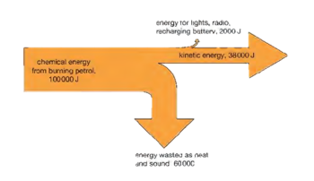

# Energy Resources and Energy Transfer

## Energy Transfers

- For energy to be useful, we need to be able to transfer it from one
  form to another.

- When transferring energy, some energy might be wasted.

- Unwanted energy transfers reduce efficiency.

- The principle of conservation of energy states that: **Energy is
  not created or destroyed in any process** (only transferred from
  one form to another).

- Sankey diagrams are a simpler and clearer way of showing what
  happens to an energy input into a system.

- The energy flow is shown by arrows whose width is proportional to
  the amount of energy involved. Wide arrows show large energy flows,
  narrow arrows show small energy flows.

- Real systems always have an unwanted energy output so can never have
  100% efficiency.

- The efficiency of an energy conversion system is defined as:

$$

\text{Efficiency} = \frac{\text{useful energy output}}{\text{total energy input}} \times 100

$$

- Efficiency does not have a unit because it is a ratio.