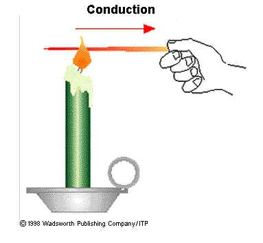

## Thermal Energy

* Thermal or heat energy is energy that is stored in 'hot' matter.
* Thermal **conduction** is the transfer of thermal (heat) energy
  through a substance by the vibration of the atoms within the
  substance. The substance itself does not move.
* **Conduction** is the flow of heat through matter from places of
  higher temperature to places of lower **temperature** without
  movement of the matter as a whole.
* In non-metals - when heat is supplied to something, its atoms
  vibrate faster and pass on their vibrations to the adjacent atoms.

* In metals – conduction happens in the previous way and in a quicker
  way –electrons are free to move, they travel randomly in the metal
  and collide with atoms and pass on the vibrations Good conductors
  are used whenever heat is required to travel quickly through
  something
* Bad conductors (insulators) are used to reduce the amount of heat
  lost to the surroundings
* **Convection** is the flow of heat through a fluid from places of
  higher temperature in places of lower temperature by movement of the
  fluid itself.
* As a fluid (liquid or gas) warms up, the particles which are warmer
  become less dense and rise.
* They then cool and fall back to the heat source, creating a cycle
  called convection current.
* As particles circulate, they transfer energy to other particles. If
  a cooling object is above a fluid it will create a convection
  current as well.
* **Radiation** is the flow of heat from one place to another by means
  of electromagnetic waves. It does **not** require a medium.
* Thermal radiation is mainly infra-red waves, but very hot objects
  also give out light waves. Infra-red radiation is part of the
  electromagnetic spectrum.

||Matt Black|White|Silver|
|:---|:---|:---|:---|
|Emitter|Best|Moderate|Worst|
|Reflector|Worst|Moderate|Best|
|Absorber|Best|Moderate|Worst|

* An emitter sends out thermal radiation.
* A reflector reflects thermal radiation, therefore is a bad absorber.
* An emitter will cool down quickly, an absorber will heat up more
  quickly and a reflector will not heat up quickly.
* The amount of radiation also depends on the surface temperature and
  surface area of a body.
* **Consequences of energy transfer include:**
  * Metal spoon in a hot drink will warm up because it conducts heat
  * Convection currents create sea breezes. During the day the land is warmer and acts as heat source. During the night the sea acts as the heat source.
  * A black saucepan cools better than a white one, white houses stay cooler than dark ones.