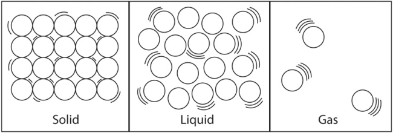
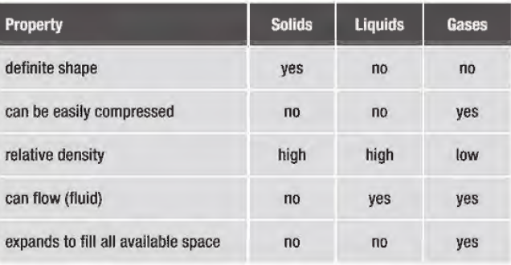
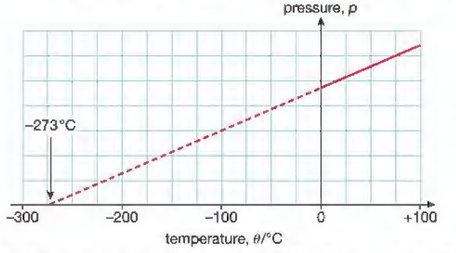

## Solids, Liquids and Gases

|**Solid**|**Liquid**|**Gas**|
|:---|:---|:---|
|Fixed shape and volume|Fixed volume but changes shape depending on its container|No fixed shape or volume, gases fill up containers|
|Strong forces of attraction between particles- particles close to each other.|Weaker attractive forces than solids- medium distances between particles|Almost no intermolecular forces- large distances between particles|
|Fixed pattern (lattice)|There is no fixed pattern; liquids take the shape of their container|Particles are far apart and move quickly|
|Atoms vibrate but can’t change position, ∴ fixed volume, and shape|Particles slide past each other|Collide with each other and bounce in all directions|

* Some other properties:

$$

\Delta Q  = mc \Delta T

$$

* When you supply energy to a substance, you would expect its temperature to rise, and this is generally true.
* The more the kinetic energy in a gas, the faster its particles move; therefore, the gas is at a higher temperature.
* The pressure gases exerted on a container are due to the particles colliding on the walls.
* The greater the kinetic energy in gasses, the faster they move, and the more often they collide on the container’s walls.
* Therefore, the volume is constant, then increasing the temperature
  will increase the pressure.
* Thus, if there is a change in the momentum of the particles, the kinetic energy decreases, decreasing the collisions on the container walls and, thus, the pressure.
* GAS LAWS:
  * **Charles's Law** gives the relationship between volume and temperature if pressure and amount of gas are held constant. Volume and temperature are directly proportional.
  * **Boyle's Law -** states that the volume of a given amount of gas held at constant temperature varies inversely with the applied pressure when the temperature and mass are constant.
  * **Pressure law -** states that for a fixed mass of gas, the pressure of a gas is directly proportional to its Kelvin temperature once the volume is kept constant.

$$
\frac{P_{1}}{T_{1}} = \frac{P_{2}}{T_{2}}
$$

* If the volume increases and the temperature stays constant, the particles hit the surface less often, thus decreasing the pressure.

$$

P_{1}V_{1} = P_{2}V_{2}

$$

**PV** = constant

* The constant is valid at a fixed gas mass at a constant temperature.
* At a temperature of - 273℃, the gas pressure would be zero. This temperature is known as 'absolute zero'.

* To convert from a Celsius scale (in °C) to a Kelvin scale
  temperature (in K), add 273 to the Celsius scale temperature:
  * temperature in K = temperature in ℃ + 273