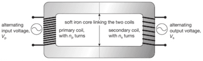

## Transformers 

On the left-hand side, there is a primary coil, and on the right-hand side, there is a secondary coil.

* These two coils are entirely two different coils.

**These two coils are wrapped around an iron core because it can be easily magnetised.**

* The primary coil is connected to a (AC) Alternating current with high voltage (P.D)

* When the current goes through the primary coil, it creates magnetic fields, constantly changing its direction.

* This magnetic field passes through the iron core, and it is passed to the secondary coil. When the current enters the secondary coil it changes the Voltage or the P.D

* The iron core is used to increase the magnetic field, and it can be easily magnetized.

* Transformers only work with the AC because we constantly need changes in the magnetic field to induce the P.D

* If there are the same number of coil turns, the PD will remain the same, assuming no energy is wasted.

* If there are more turns in the secondary coil, the PD will be greater than the current in the primary coil. This is called a **step-up transformer**.

* If there is a double number of turns, then the P.D. will also be doubled.

* Step-down transformers are transformers with more number of turns in the primary coil.

### Equations

$\frac{\text{Input Voltage,} V_p}{\text{Output Voltage,} V_s} = \frac{\text{Number of turns on Primary coil,} n_p}{\text{Numer of turns on Secondary coil,} n_s}$

$$

\frac{V_p}{V_s} =\frac{n_p}{n_s}

$$

$\text{Input Power,} V_{p}I_{p} = \text{Output Power,} V_{s}I_{s}$

$$

V_{p}I_{p} = V_{s}I_{s}

$$