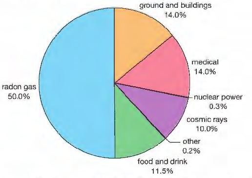
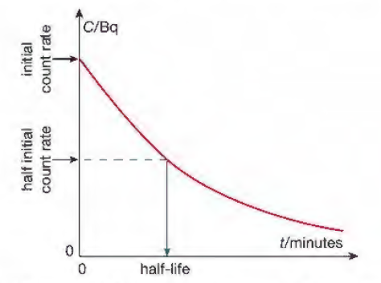
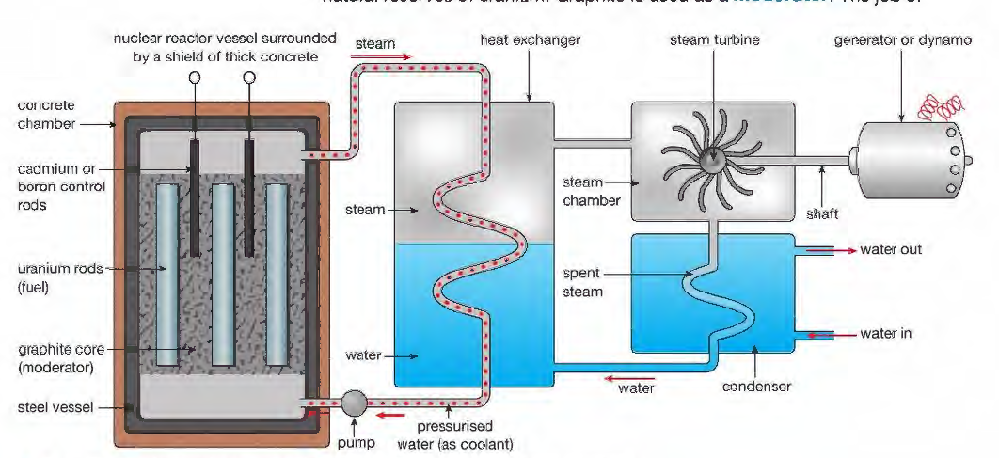

# Radioactivity and Particles

## Atoms and Radioactivity

* **Atoms consist of:**
  * **Nucleus:** central part of atom made of protons (positively
    charged) and neutrons. These two types of particles are called
    nucleons. They are bound together by the strong nuclear force.
  * **Electrons:** almost mass-less particles which orbit nucleus in
    shells
* This is proved by Rutherford’s Gold Foil Experiment
* **Proton number:** number of protons in an atom
* **Nucleon number:** the number of nucleons (protons + neutrons) in
  an atom
* **Isotope:**
  * Atoms of the same element that have different numbers of
    neutrons e.g., Carbon-12 and Carbon-14.
  * There are non-radioactive isotopes and radio-isotopes.
  * Radio isotopes are unstable atoms, which break down giving
    radiation
* Radioactive emissions occur randomly over space & time

||**Alpha** **(α)**|**Beta** **(β)**|**Gamma** **(γ)**|
|:---|:---|:---|:---|
|**Nature**|Helium nucleus (2 protons & 2 neutrons)|One high speed electron|Electro-magnetic radiation|
|**Charge**|+2|-1|none|
|**Penetration**|Stopped by paper|Stopped by aluminium|Only reduced by lead|
|**Effect from fields**|Deflected|Very deflected|Not deflected|
|**Ionizing effect**|Very strong|Weak|Very weak|
|**Speed**|1⁄10 c|9⁄10 c|c|

* Depending on their charge, they will be affected by electric and
  magnetic fields.
* The parent nucleus becomes a daughter nucleus and a particle (decay
  products).
* The nucleus changes when undergoing alpha or beta decay

**Alpha decay:** An element with a proton number 2 lower and nucleon
number 4 lower, and an alpha particle is made (2p + 2n)

e.g. ${}^{226}_{88}\text{Ra} \rightarrow {}^{222}_{86}\text{Rn} + {}^{4}_{2}\alpha$

**Beta decay:**

* A neutron changes into a proton, an electron and an antineutrino so
  an element with the same nucleon number but with a proton number 1
  higher e.g.

e.g. ${}^{131}_{53}\text{I} \rightarrow {}^{131}_{54}\text{Xe} + {}^{0}_{-1}\beta + {}^{0}_{0}\bar{\nu}_e$

* Gamma emission causes no change in mass number or atomic number; they emit energy
* Some isotopes do not change in mass or atomic number however they
  emit energy as their particles rearrange themselves to become more
  stable

### **Radiation and Half-Life**

* The unit of radioactivity is the becquerel (Bq). It is a measure of how many unstable nuclei are disintegrating per second.
* **Background radiation:** a small amount of radiation around us because of radioactive materials in the environment. Mainly comes from natural sources such as soil, rocks, air, building materials, food and drink – and even space.

**Sources of Background Radiation:**

* A Geiger-Müller (GM) tube can be used to detects *α*, *β* and *γ*
  radiation.
* **Radioactive decay:** A radioisotope (unstable arrangement of
  neutrons and protons) is altered to make a more stable arrangement.
* **The half-life of a radioisotope:** is the time taken for half the nuclei present in any given sample to decay.
* Some nuclei are more stable than others.
* Remember to factor background radiation in half-life calculations
  involving tables and decay curves.
* The decay rate, C, corrected for background radiation, is proportional to the amount of radioactive isotope present. If we plot a graph of C against time, *t,* we can measure the half-life
  from the graph.

* **Half-life calculations:** Graphs of activity, in becquerels,
  against time can be used to find the half-life of an isotope, and
  this half-life information can be used to make predictions of the
  activity of the radioisotope at a later time.

### **Applications of Radioactivity**

* Uses:
  * **Medical use:** cancer treatment (radiotherapy) – rays kill cancer cells using cobalt-60
  * **Industrial use:** to check for leaks – radioisotopes (tracers) added to oil/gas. At leaks radiation is detected using a Geiger counter.
  * **Archaeological use:** carbon 14 – used for carbon dating.
* Radioactive material is stored in a lead container
* Picked up with tongs, not bare hands
* Kept away from the body and not pointed at people
* Left out of its container for as short a time as possible

### **Fission and Fusion**

* Nuclear reactions involve a change in the qualities of atoms. Heavy
  atoms split into lighter atoms and other pieces in a process called
  fission.
* Lighter atoms may be forced to join together to make heavier atoms
  in a process called fusion.
* Uranium-235 is used as fuel in a nuclear reactor.
* It is used because a neutron can split its nuclei. The process of splitting an atom is called fission.
* In the fission reaction, a slow-moving neutron is absorbed by a
  nucleus of U-235.
* The resulting nucleus of uranium-236 is unstable and splits apart.
* The fragments of this decay are the two daughter nuclei of
  barium-144 and krypton-89.
* The fission reaction produces a huge amount of energy.
* If more than one neutron from each fission causes fission in
  surrounding nuclei, then the reaction gets faster and faster. This
  is called a chain reaction.
* Each fission results in more nuclei splitting apart.
* If the process is allowed in a nuclear reactor, the reactor core overheats, resulting in a nuclear explosion with the sudden release of enormous amounts of heat energy and radiation.
* In a nuclear reactor, the process is controlled so heat energy is released over a longer period of time.
* The heat produced in the core or heart of the reactor is used to
  heat water.
* The steam produced then drives turbines to turn generators.

* In the reactor, graphite is used as a moderator.
* The moderator absorbs some of the kinetic energy of the neutrons to
  slow them down.
* The control rods are made of boron or cadmium.
* They absorb the neutrons and take them out of the fission process
  completely.
* The reactor vessel is made of steel and surrounded by a concrete layer which prevents any radiation escaping.
* Fusion is the energy source for stars.
* The problem in fusion is creating the very high temperatures needed
  to make the deuterium and tritium nuclei collide.
* Enough energy to overcome the repulsive force between the positive
  electric charge in the nuclei of each isotope is needed.