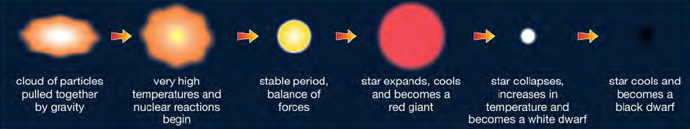
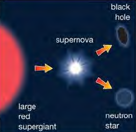
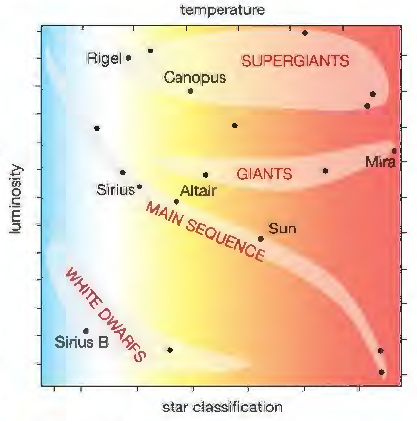

## Stellar Evolution

* Our galaxy is a spiral galaxy called the Milky Way.
* The colours of stars tell us about their temperatures. A very hot
  star emits blue in its spectrum and therefore looks blue, a medium
  star like our Sun looks yellow and cooler stars appear red.

### 3 ways astronomers describe the brightness of a star

* The apparent brightness or magnitude of a star. This is the easiest method and is simply a measure of how bright a star is as seen from the Earth.
* The absolute brightness or magnitude. This is a measure of how bright stars would appear if they were all placed the same distance away from the Earth.
* The luminosity of a star. This measures how much energy in the form of light is emitted from a star's surface every second.

### The Life Cycle of a Star (Similar in Size to the Sun)

* When a star first forms, gravitational forces are pulling particles
  together.
* When nuclear reactions begin, the high temperatures create forces
  that try to push the particles When these two forces are balanced,
  the star is said to be in its main stable period.
* A star in this main stable period is referred to as a main sequence
  star.
* Towards the end of this stable period, there are fewer hydrogen nuclei and eventually, the hydrogen fusion reactions stop.
* As the star shrinks in size, there is a large increase in temperature. So high that fusion reactions between helium nuclei begin. The energy released by these reactions causes the star to expand to many times its original size.
* As it expands, it becomes a little cooler, and more of its light energy is emitted in the red part of the spectrum. The star is changing into a red giant.
* Sometime later, when most of the helium nuclei have fused (joined) together, new nuclear reactions begin, but now the compressive or squashing forces are larger, and the star begins to get smaller or contract.
* This contraction causes an increase in temperature, so the star again changes colour.
* It now emits more blue and white light. It has changed into a white
  dwarf star.
* Finally, as a white dwarf star cools, it changes into a cold black dwarf star.

### The Life Cycle of a Massive Star

* A star that is much larger than our Sun will expand into a large red
  supergiant.
* As it contracts, it becomes unstable. It explodes, throwing dust and gas into space to form a new stellar nebula. This exploding star is called a supernova.
* Any matter remaining will form a very dense neutron star. If the
  neutron star has a mass that is approximately five times greater
  than that of our Sun or more, it collapses further to become a black
  hole.

* **The Hertzsprung-Russell diagram (HR diagram):** shows the
  relationship between the brightness, temperature and classification
  of a star.

