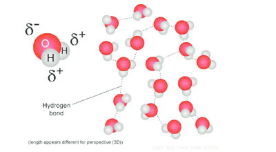

# Molecules, Transport and Health

## The Chemistry of Life

- **Water** is liquid at normal temperatures, while other small molecules, like CO2 and O2, are gas.

**Features of water and its significance to life:**

- **Hydrogen bonding:** The weak electrostatic intermolecular force between a partially positive hydrogen that is bonded to a partially negative oxygen and other polar molecules nearby. Partially positive regions in water like Hydrogen are represented with δ+ and partially positive and partially negative regions in water regions like Oxygen are represented with δ-.

- **Solvent:** Water is an effective solvent because of its polarity and so can form electrostatic interactions with other polar molecules and ions. Thus, it is a transport medium and reagent for metabolic and other reactions in plant and animal cells.
- **High surface tension and cohesion:** Cohesion refers to the attraction of one water molecule to each other. Water molecules have strong, cohesive forces due to hydrogen bonds, thus having high surface tension.
- **High specific heat capacity:** The amount of heat energy required to raise the temperature of 1 kg of water by 1 °C. Water has high SHC due to its hydrogen bonds. The temperature within organisms remains constant compared to external temperature, and water bodies also have a slow change in temperature, providing stable aquatic habitats.
- **High latent heat of vaporisation:** A measure of the heat energy needed to vaporise a liquid. Water has a high LHV due to its high SHC as H bonds need to be broken before water can be vaporized, cooling the surrounding environment. Sweating is a good cooling mechanism.
- **Density and freezing properties:** Ice is less dense than water and floats on it, insulating water and preventing it from freezing, preserving aquatic life underneath it. Changes in the density of water with temperature causes currents, which helps to maintain the circulation of nutrients in the oceans.