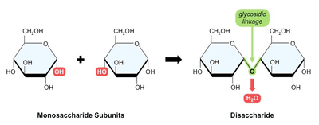
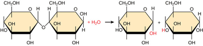

## Monosaccharides and Disaccharides

* **Monosaccharides** are made up of Carbon, Hydrogen, and Oxygen.

* They have the general formula C$\\_n$(H$\\_2$O)$\\_n$ where n represents the number of carbon atoms.

* Due to their structure, they are able to be broken down quickly by living organisms to produce ATP energy.

* Properties of Monosaccharides:

  * Sweet
  * Soluble in water
  * They have an osmotic effect
  * Crystalline in nature

* Examples of Monosaccharides:

  * α-glucose
  * Fructose
  * Galactose

* **Disaccharides** form when two monosaccharides join in a condensation reaction.

* Condensation reaction is the process in which two OH groups of two monosaccharides eliminate 2 Hydrogen atoms and 1 Oxygen atom, releasing water and forming a glycosidic bond.

  

* Properties of Disaccharides are similar to Monosaccharides.

* The bond formed between the two monosaccharides is called a glycosidic bond.

|Disaccharide|Forming Units|
|:---|:---|
|Maltose|α-glucose + α-glucose|
|Sucrose|α-glucose + Fructose|
|Lactose|β-glucose + Galactose|

* Disaccharides can also be broken down in a hydrolysis reaction.

* Hydrolysis reaction is the process in which a water molecule is reintroduced into a glycosidic bond which breaks it.

  