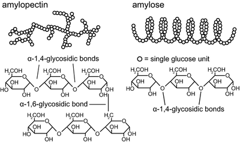

## Polysaccharides

* **Polysaccharides** are made up of monomers joined together by glycosidic bonds in condensation reactions.

* Properties of Polysaccharides:

  * They are macromolecules with a large molecular mass
  * Formed from a large number of monomers
  * Contains Glycosidic bonds between monomers
  * No sweet taste
  * No Osmotic effect/insoluble in water

* **Starch:** is a polysaccharide that is found in plant cells and is made up of two components, amylose and amylopectin. These components are made from α-glucose molecules and contain glycosidic bonds. Starch is highly compact and stores energy.

  

||Amylose|Amylopectin|
|:---|:---|:---|
|**Structure**|1,4 glycosidic bonds|1,4 and α 1,6 glycosidic bonds, giving its branched structure|
|**Shape**|Helical and more compact|Branched|

* **Glycogen:** is a Polysaccharide that is used for the storage of energy is animal cells and is also made from α glucose molecules. The structure of glycogen is very similar to that of amylopectin. However, it is much more branched, allowing it to be hydrolysed rapidly.