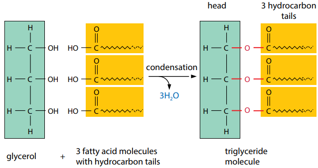

## Lipids

* **Triglyceride:** forms by the condensation of 3 fatty acid chains
  and one glycerol molecule, forming ester bonds. Fatty acid chains
  are long hydrocarbon chains with a carboxylic head. Glycerol is an
  alcohol-containing 3 OH groups.

||Unsaturated fatty acid|Saturated fatty acid|
|:---|:---|:---|
|**Bond**|At least 1 C=C double bond|No C=C double bond|
|**Structure**|Contains bent chains (kinks)|Straight chain|
|**H:C Ratio**|Lower H:C ratio|Higher H:C ratio|

* **Role of triglyceride:**
  * Better energy reserves than carbohydrates as more CH bonds
  * Acts as an insulator and provides buoyancy
  * A metabolic source of water as gives CO$\\_2$ and H$\\_2$O on oxidation in respiration