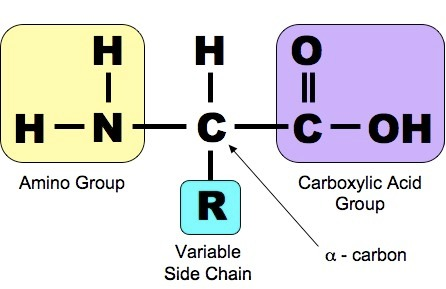
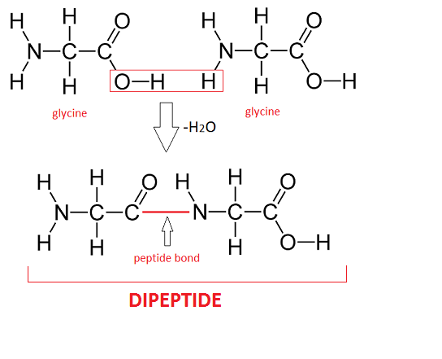
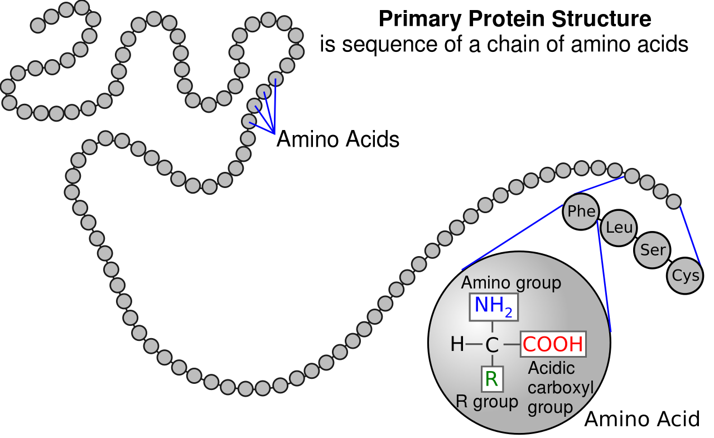
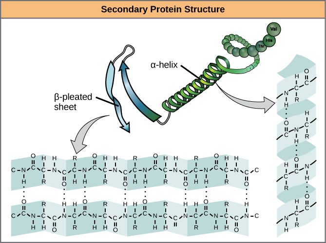
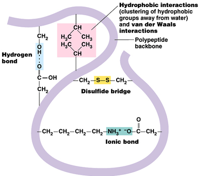
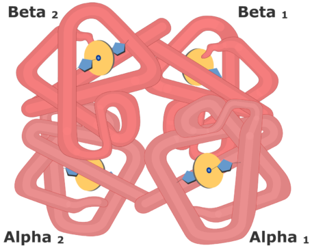
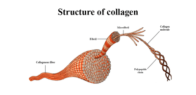

## Proteins

* Proteins are made of amino acids which only differ in the R- groups/
  variable side chains and will always contain an amine group (basic),
  carboxyl group (acidic) and a hydrogen atom attached to the central
  carbon atom.

* A peptide bond is formed by condensation between 2 amino acids,
  forming a dipeptide. Many amino acids that join together by peptide
  bonds form a polypeptide.

* Peptide bonds are broken when hydrolysed into amino acids.

**Structure of Proteins**:

* **Primary Structure**: The sequence of amino acids held together
  by polypeptide bonds in a polypeptide chain.

* **Secondary Structure**: the structure of a protein molecule
  resulting from the regular coiling or folding of the chain of
  amino acids.

  * **α- helix**: the polypeptide chain twists into a regular
    spiral and is maintained by hydrogen bonds between the (-NH)
    group of one amino acid and the (CO-) group.
  * **β- pleated sheet:** the chain is not tightly coiled and
    lies in a looser, straighter shape.

* **Tertiary Structure:** the precise folding and coiling of
  alpha-helices and beta-pleated sheets of an amino acid chain.
  They are held together by:

  * Hydrogen bonds between a wide variety of R- groups

  * Disulfide bridges between two cysteine molecules

  * Ionic bonds between R groups containing amine and carboxyl
    groups.

  * Hydrophobic interactions between non-polar R groups.

* **Quaternary Structure:** the three-dimensional arrangement of two or
  more polypeptides, or a polypeptide and a non-protein component such
  as haem, in a protein molecule. The polypeptide chains are held
  together by bonds in the tertiary structure.

* **Globular proteins:** curl up into a spherical shape with their
  hydrophobic regions pointing into the centre of the molecule and
  hydrophilic regions pointing outwards. They are soluble in water,
  e.g. enzymes and haemoglobin.

  * **Haemoglobin:** a globular protein that has a quaternary structure with 4 polypeptide chains, 2 α-globin and 2 β-globin chains, each connected by disulfide bridges. Each chain has one prosthetic haem group containing an iron atom that reversibly binds to an oxygen molecule. Oxyhaemoglobin is bright red when the haem group is combined with oxygen. Otherwise, it is purplish. Haemoglobin is an example of a *conjugated* protein.

* **Fibrous proteins:** form long strands, are insoluble in water and have structural roles, e.g. collagen, hair, nails.

  * **Collagen:** a fibrous protein that is made up of three polypeptide chains in a helical structure held together by hydrogen bonds where each polypeptide chain is made up of a repeating sequences of the amino acids glycine, hydroxyproline and proline.

