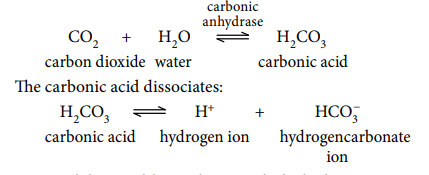
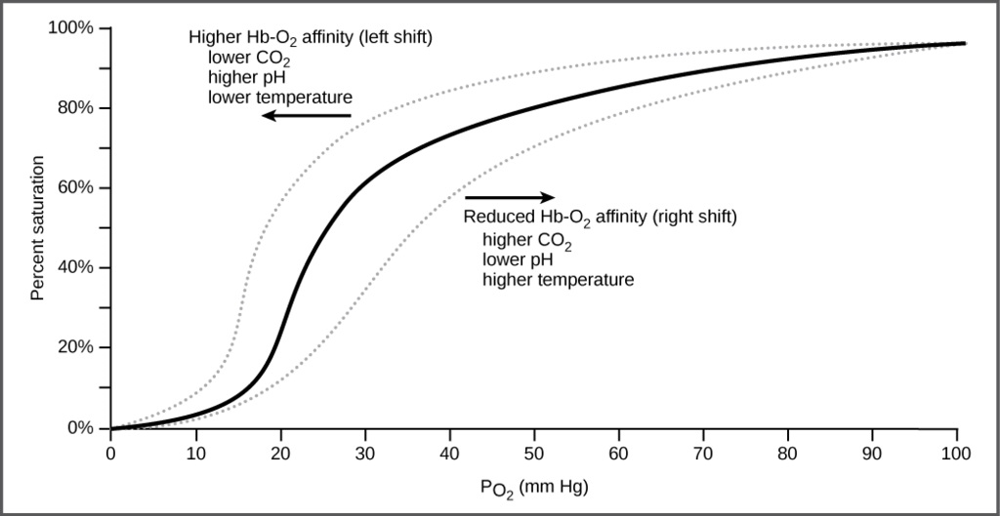

## The Roles of the Blood

* **Blood** is composed of 4 components:
  * **Plasma**: This is the liquid part of the blood. It is a dilute solution of salts, glucose, amino acids, vitamins, urea, protein, and fats.
  * **Leukocytes (white blood cells):** Involved in the immune system.
  * **Platelets**: Involved in blood clotting.
  * **Erythrocytes (red blood cells)**: Involved in carrying oxygen and carbon dioxide.
* Adaptations of red blood cells to carry out its function:
  * Biconcave, allowing for a greater surface area to volume ratio to carry oxygen
  * No nucleus nor mitochondrion, allowing more space for haemoglobin
  * Small diameter to allow it to squeeze through capillaries
* **Haemoglobin (Hb)**: is a red oxygen-carrying pigment found in RBCs and is a globular protein. It is made of 4 polypeptide chains each containing an iron ion.
* **Partial pressure**: pressure exerted by a type of gas in a mixture of gases, usually represented with “p”. Example: pO$\\_2$ means partial pressure of oxygen
  * **In respiring tissues**: The pCO$\\_2$ is high, and the pO$\\_2$ is low.
    * CO$\\_2$ from the cells diffuses into the plasma.

    * CO$\\_2$ combines with Hb to form carbaminohaemoglobin. (10% carried this way)

    * Most CO$\\_2$ combines with water (catalysed by carbonic anhydrase) to form carbonic acid, which then dissociates into H$^{+}$ and HCO$\\_{3}^{-}$ ions.

* H$^{+}$ ions combine with Hb to form Haemoglobinic acid (HHb).

* **In the lungs**: pO$\\_2$ ­­high and pCO$\\_2$ low.

  * CO$\\_2$ in plasma diffuses from the blood into the alveoli, and oxygen diffuses into the blood from the alveoli.
  * Carbaminohaemoglobin dissociates to form CO$\\_2$ and Hb
  * Hb then picks up O$\\_2$, and HHb (haemoglobinic acid) dissociates to form H$^{+}$ and Hb.
  * The H+ ions combine with HCO$\\_{3}^{-}$ to form carbonic acid, which dissociates to form CO$\\_2$ and water (catalysed by carbonic anhydrase).
  * CO$\\_2$ diffuses into alveoli.

* The presence of a high pCO$\\_2$ causes Hb to release oxygen. This is called the **Bohr Effect**. High pCO$\\_2$ are found in actively respiring tissues that need oxygen. This causes Hb to release oxygen even more readily than it would otherwise. Shown below is an oxygen dissociation curve.

* The sigmoidal shape of the oxygen dissociation curve can be explained:

  * As we know, a haemoglobin molecule is composed for 4 sub-units (2 alpha and beta globins).
  * It is difficult for the first oxygen molecule to bind with a haem group in a globin, causing a slow increase in the curve.
  * After this, it becomes easier for additional oxygen molecules to bind with the rest of the haem groups due to conformational changes, causing a steeper increase in the curve.
  * As haemoglobin becomes saturated, less oxygen molecules can bind to it, causing the curve to flatten

* **Fetal Haemoglobin**: It is present in the blood of a developing
  fetus. It has a higher affinity to oxygen compared to adult
  haemoglobin. Allowing it to “absorb” oxygen from the mother’s blood,
  ensuring proper growth.

* The **blood clotting** mechanism:

  * Upon injury, the platelets break
  * This releases several chemicals that aid in the blood clotting process, causing a cascade of reactions
  * **Serotonin**: is a chemical that causes smooth muscles to contract, narrowing blood vessels
  * **Thromboplastin**: is a globular protein that catalyses the reaction of prothrombin to thrombin in the presence of Ca$^{2+}$ ions
  * Prothrombin and thrombin are both soluble globular proteins in the blood. Prothrombin is present in the plasma
  * Thrombin catalyses the reaction of Fibrinogen to Fibrin
  * Fibrinogen is a soluble globular protein, while Fibrin is an insoluble protein.
  * Fibrin forms a mesh-like structure that traps red blood cells allowing the clot to dry up and form a scab

* Benefits of blood clotting include:

  * Preventing excess blood loss
  * Preventing the entry of pathogens