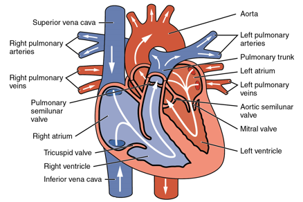
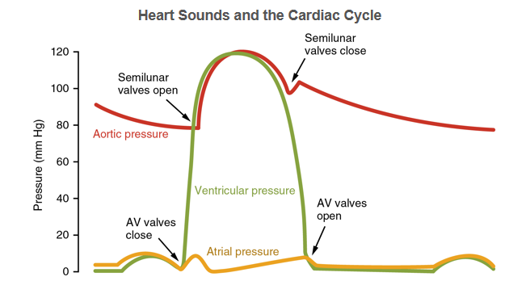

## The Mammalian Heart

- **External structure** : Blood vessels that leave the heart are the
  Aorta and pulmonary artery. Blood vessels that enter the heart are
  the superior vena cava, the inferior vena cava, and the pulmonary
  vein. The septum separates the left and right sides of the heart.

- **Internal structure:** The human heart has four chambers:

- **Atria**: 2 upper chambers are known as atria. They are thin-walled
  and receive blood at low pressure.

- **Ventricles**: 2 lower chambers are known as ventricles. They are
  thick-walled, receive blood from atria, and pump it out through
  arteries.

- The left ventricle has a thicker muscular wall, as it has to
  pump blood into the systemic circuit, which has a higher
  resistance to blood flow than the pulmonary circuit. The
  systemic circuit is also longer and requires more pressure.

\

**The cardiac cycle is divided into 3 stages:**

- **Atrial Systole**: This occurs when muscles in the atria
  contract and blood passes on to the ventricles. 70% of the blood
  flows passively down to the ventricles. The *bicuspid* and
  *tricuspid* valves open while the *semilunar* valves are closed.

- **Ventricular systole**: After Atrial Systole, the ventricles
  contract increasing the blood pressure and pushing it out of the
  heart. The blood passes through the Aorta and pulmonary
  arteries. The *semilunar* valves open and the *bicuspid* and
  *tricuspid* valves are closed.

- **Diastole**: All muscles of the heart relax, and the pressure
  inside ventricles becomes lower than the atria. When this
  happens, most of the blood starts to flow from the atria to the
  ventricles even though the atria is not contracting. However,
  the atria contracts towards the end to push out the last bit of
  blood into the ventricles, and the cycle begins all over again.

