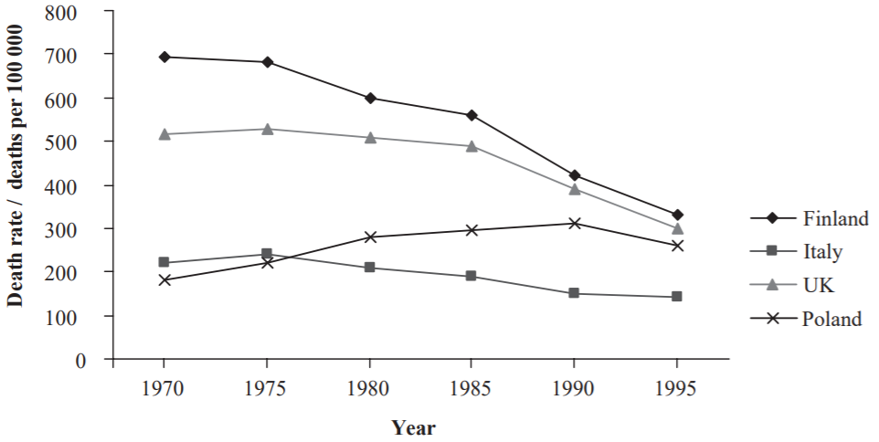
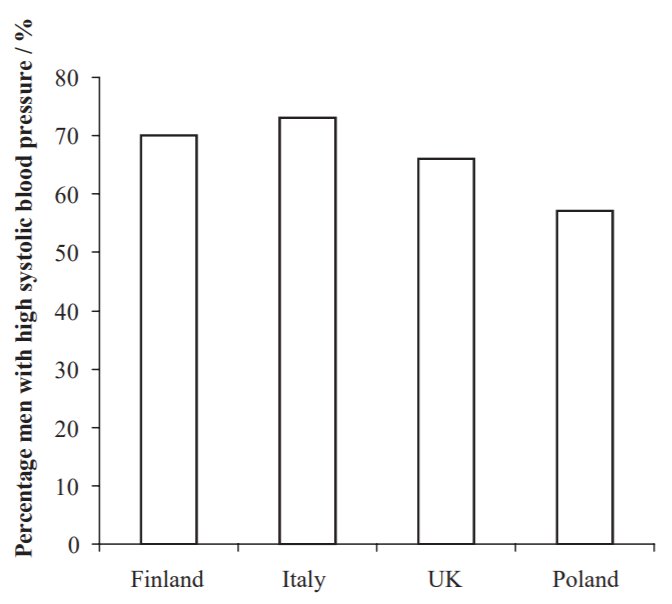

## Risk, Correlation, and Cause

* **Epidemiology**: The study of disease patterns to find a
  correlation between a disease and certain risk factors.
* **Risk**: The probability of damage occurring
* **Actual risk**: Factors increasing the probability of getting a
  disease.
* **Perceived** **risk**:
  * Overestimating the risk of something happening due to the
    unfamiliarity of the risk
  * Underestimating the risk of something happening due to it being
    in the far-future
* **Multifactorial diseases**: A disease caused by interactions of
  multiple factors.
* **Causation**: When a change in 1 variable is responsible for a
  change in another variable.
* **Correlation**: When a change in 1 variable is reflected by a
  change in another variable.

### **Conflicting Evidence**

* The graph shows death rates from coronary heart disease (CHD) in men from 1970 to 1995 in 4 countries

* Another graph shows the percentage of men from these countries in 1980 with high systolic blood pressure.

* It has been suggested that there is a link between high blood pressure and death from CHD.

* i) Using both graphs, give 2 pieces of evidence to support this hypothesis

* ii) Suggest how the data shown in the graphs do not fully support this hypothesis

### **Answer**

**Part (i)**

1.  Finland has a high percentage of men with high blood pressure and at the same time has high rates of CHD

2.  UK has a high percentage of men with high blood pressure and at the same time has high rates of CHD.

**Part (ii)**

* It contains conflicting evidence. Italy has a high percentage of men with high blood pressure but has low death rates from CVD.