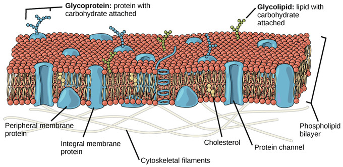
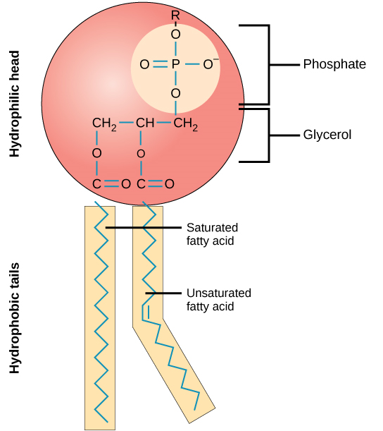
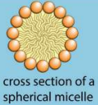

# Membranes, Proteins, DNA, and Gene Expression

## Cell Membranes

- **Fluid Mosaic Model**: Two scientists, Singer and Nicolson, put
  together a cell membrane model based on the evidence available. The
  term ‘fluid’ describes how individual phospholipid and protein
  molecules move around within their monolayer. The word ‘mosaic.’
  describes the pattern produced by scattered protein molecules when
  the surface of the membrane is viewed from above.

- **Phospholipid:** The hydrophilic *head* contains a phosphate group
  and glycerol, while the hydrophobic *tail* contains 2 fatty acid
  chains. This is due to the partial negative charge on the phosphate
  group that gets attracted to the partial positive charge on the
  hydrogen atom of the water molecule.

- **Phospholipid bilayer:** This provides the basic structure of
  membranes; it is selectively permeable and acts as a barrier to most
  water-soluble substances.

  - The more unsaturated the tails, the more fluid the membrane as
    unsaturated fatty acid tails are bent and, therefore fit together
    more loosely.

  - The longer the tail, the less fluid the membrane.

- **Micelle:** phospholipid molecules that arrange themselves spherically in aqueous solutions.

- **Cholesterol:** regulates the fluidity of membranes. Its
  hydrophobic region prevents polar molecules from passing through the
  membrane.