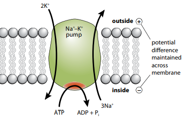

## Cell Transport and Diffusion

**Passive transport**:

- **Simple Diffusion**: The net movement of molecules or ions from a region of high concentration to a region of low concentration, down the concentration gradient.

- **Facilitated diffusion:** The net movement of molecules down the concentration gradient. Molecules go through channel proteins or carrier proteins instead of passing through phospholipids. This allows for the passage of large polar ions and molecules e.g. glucose, amino acids, Na$^{+}$

- Passive transport requires no ATP energy

$$

\text{Fick's Law of Diffusion} = \frac{\text{Surface Area} \times \text{Difference in Concentration}}{\text{Thickness of Exchange Surface}}

$$

**Active transport**: Involves the use of **carrier proteins** to move substances against the concentration gradient using ATP energy. **ATPases** are a group of enzymes the can hydrolyze (break down ATP to ADP to release energy) or synthesize ATP (phosphate group is added to ADP to form ATP). 

**Cytosis:**

- **Exocytosis**: The bulk movement of substances from inside the cell to the outside using vesicles. Vesicles fuse with the cell membrane and release their contents.

- **Endocytosis**: The bulk movement of substances from outside the cell to the inside using vesicles formed by the cell membrane.