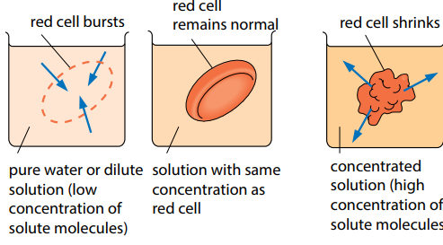
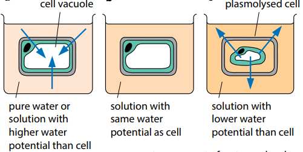
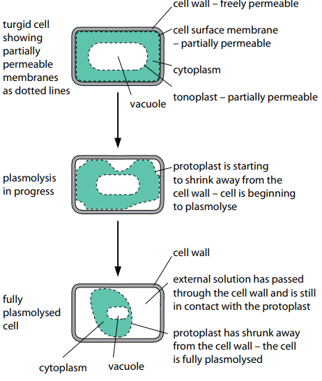

## Osmosis: A Special Case of Diffusion

- **Osmosis:** The diffusion of water molecules down a water potential gradient through a permeable membrane.

- **Isotonic Solution:** The concentration of solute on both sides is equal.

- **Hypotonic Solution**: The concentration of solute in the solvent is less than the cell.

- **Hypertonic Solution:** The concentration of solute in the solvent is more than the cell.

### **Osmosis in animal cells:**

### **Osmosis in Plant Cells:**

- **Protoplast**: the living part of the cell inside the cell wall

- **In pure water**: water enters the cell by osmosis, and the
  cell wall pushes back against the expanding protoplast, building
  up pressure rapidly, becoming turgid.

- **In concentrated solution:** water will leave the cell by
  osmosis. The protoplast gradually shrinks until it is exerting
  no pressure on the cell wall. The protoplast continues to shrink
  and pull away from the cell wall, so the cell is plasmolysed.
  The point at which plasmolysis is about to occur is referred to
  as *incipient plasmolysis*.

### **How plasmolysis occurs:**

